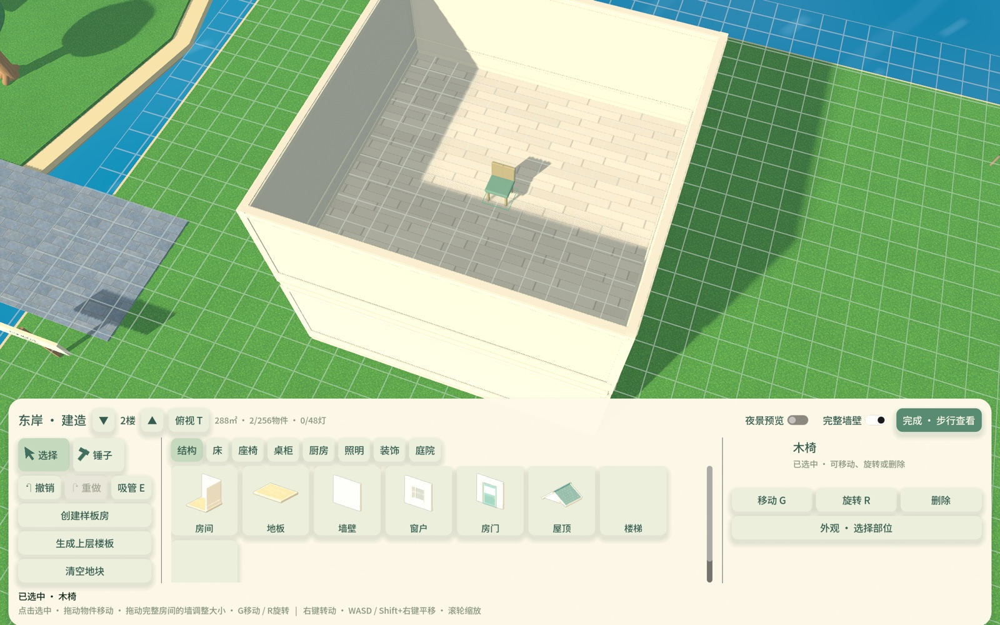
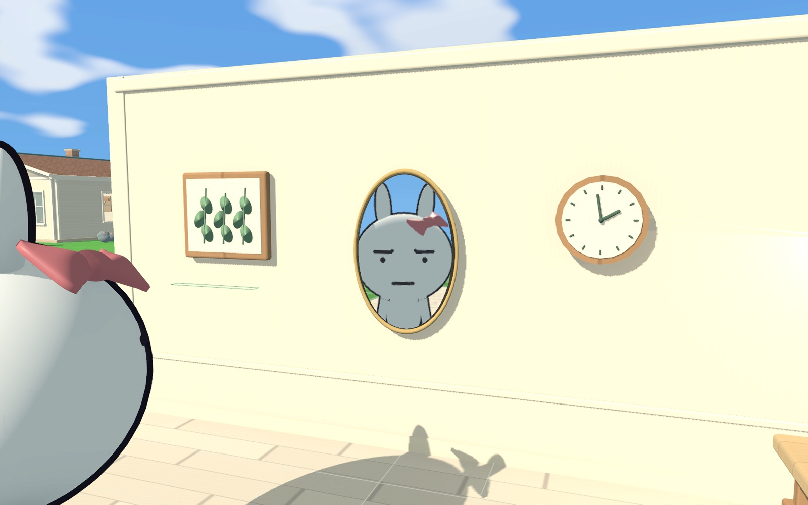

# 墙壁选取与镜面同步验证

2026-11-06的阶段验证记录。墙体选取修复仍有效；以下双镜限制与像素预算已由[多镜面实现](多镜面反射优化与验收_2026-11-06.md)替代。正式版仍为0.3.3/build6，未部署发布。全部运行使用`--test`隔离进度，没有读取或改写真实玩家存档，也没有生成地图。

## 完整墙壁与楼层选取

修复前新增的`building_selection_flow`在两层房屋的二层、四层房屋的四层各复现三项错误：打开完整墙壁后，家具、地板、墙的选取均命中隐藏屋顶，共6项失败。屋顶记录与当前最高层同属一层，不在`other_storey_bodies`里；原代码只有剖切模式才排除屋顶碰撞，因此开启完整墙壁时选取射线先撞到屋顶。

现在独立判断隐藏屋顶与剖切墙：室内无论开关状态都排除屋顶的选取碰撞；只有进入明确的屋顶视图才允许选屋顶。没有关闭真实屋顶碰撞，也没有改动物理层或人物行走规则。

旧“查看完整墙壁”显示本层及下层完整结构，旧“整栋墙壁”显示跨层结构作参照；二者都隐藏屋顶，并且仍只允许修改当前层。现已删除后一个开关及其额外状态，只保留“完整墙壁”：开启显示本层及下层完整墙，关闭剖切本层；上层保持隐藏，切层保留开关。最高层再向上进入屋顶视图查看整栋。挂墙工具仍自动开启完整墙壁。

整栋专用状态删除后，楼梯预览直接按上层板的现有可见方式显示开洞；上层板原为仅投影时，预览也保持仅投影，不会把隐藏天花板突然显示出来。

回归还定位了手势输入路由问题：旧逻辑读取实时鼠标位置和上次GUI悬停，可能与本次手势位置不同。现改为使用`InputEventGesture.position`，并确认悬停控件/滚动容器实际包含该位置；新增旧指针在UI/场景而当前手势在另一处的双向测试，确保目录滚动不穿透、场景缩放不被误挡。

## 镜面实现与取舍

保留共享世界的非对称视锥平面反射：根据主相机的位置，计算镜面对称的观察点，按镜面的实际边界裁剪反射视图。因此能照出主画面后方的人物和物体，并正确改变视差，无需复制房间或人物。

这次优化调度和分辨率，而非用低频画面节流：

- 取消18米硬距离限制和静止30次/秒、移动60次/秒的共享轮流预算。最多两面可见镜子在每一主帧都提交更新，包括相机静止而人物移动时；反射相机关闭物理插值，避免在逐帧更新的相机变换上重复插值。
- 按镜面投影边长及主3D渲染比例分配纹理。高64～640像素、32像素分档，缩小使用迟滞以减少微小移动时反复分配；两面合计不超过327,680像素。优先降低远处镜面的像素数，保持时间上的连续性。
- 以屏幕覆盖判断可见性：背面、屏外、完全遮挡或投影面积不足4屏幕像素停止绘制。建造时隐藏的屋顶及剖切墙不作为遮挡物；检测椭圆内部中心及四个方向，避免仅中心受挡就整面关闭。
- 保持已有镜面与视口的绑定，给已绑定镜面15%的排序迟滞，避免微小排名变化时交换纹理。首次有效画面约0.125秒淡入，避免突然跳出。
- 反射视图保留2×MSAA，关闭SSAO、SSIL、SSR、辉光与局部灯光阴影图集；不继续递归渲染镜中镜，超过两面的镜面保留原高光材质。没有降低全局画质或主画面的帧率设置。

与常见方案的比较：平面反射适合规则家用镜面；SSR只使用主画面数据，无法可靠反射屏外角色；环境探针适合粗略环境及金属高光，近处人物和视差不够准确；硬件光追能处理复杂反射，但需要额外硬件及渲染管线支持。本项目继续优化平面反射更合适。参考[Unreal平面反射](https://dev.epicgames.com/documentation/en-us/unreal-engine/planar-reflections-in-unreal-engine)、[Unity平面反射探针](https://docs.unity3d.com/Packages/com.unity.render-pipelines.high-definition@16.0/manual/Planar-Reflection-Probe.html)、[Godot反射与后处理](https://docs.godotengine.org/en/4.6/tutorials/3d/environment_and_post_processing.html)。

没有找到EA官方对《模拟人生3》镜面管线的完整说明；不可把具体底层优化写成已知事实。直接修改该游戏镜面参数的[开源补丁作者说明](https://github.com/sims3fiend/Sims3SettingsSetter#graphics-patches)记录了基础距离与尺寸衰减，并指出每面镜子有额外相机渲染；这是第三方分析，不是EA技术文档。因此不把玩家观察到的流畅效果解读为镜面没有渲染成本或绝对没有距离限制。

## 验证与性能

22组功能回归通过，共2,924项计数检查（含既有和重复检查，不代表独立功能数）；另完成5个同条件性能场景。最终日志、截图、源码哈希和同条件新旧性能JSON保留在[evidence](evidence/wall-picking-mirror-sync-20261106/summary.json)。固定证据只选最终通过的运行；失败复现另存`selection-before.log`，不计入通过数量。

验证覆盖：两层/四层逐层家具、地板、墙选取，剖切/完整墙与屋顶视图；单一开关及切层保留；主镜头后方真实像素、投影四角、静止镜头下动态物件、双镜逐帧更新、17/19/26/35米连续反射、近距离总像素上限、部分/完全遮挡、屏外、背面，以及隐藏屋顶不拦截镜面刷新。相关建造、楼梯、外观、保存、UI滚动与用餐检查见固定日志。

性能采用M1 Pro、Godot4.6.3、Metal Forward+、3024×1890窗口、主3D比例约0.592（约200万像素），固定两面镜子与移动角色。关闭VSync和帧率限制；为避免macOS后台不绘制，关闭自动渲染循环，每次`process_frame`显式绘制一次，每条件预热0.8秒、采样2.2秒。计时包含完整帧的处理、渲染与同步；单独的主视口CPU计时不包含其他视口，GPU计时为0表示此设备接口未提供，不代表没有GPU成本。不能与重复强制绘制或仅CPU提交时间混用。

同条件新旧对照如下（中位 / P95，毫秒）：

| 场景 | 原实现 | 新实现 | 反射刷新与像素 |
| --- | ---: | ---: | --- |
| 关闭反射 | 6.548 / 6.676 | 6.547 / 6.677 | 基准 |
| 近处、相机静止、角色移动 | 6.557 / 7.460 | 7.926 / 8.149 | 原双镜合计约29次/秒；新双镜每主帧都更新；188,928 → 47,232像素 |
| 近处、相机及角色移动 | 6.626 / 7.585 | 7.957 / 8.149 | 新版约1.993次反射提交/主帧，接近每帧两面都更新；188,928 → 47,232像素 |
| 远处、相机及角色移动 | 6.446 / 6.573 | 7.307 / 7.468 | 原版无反射，新版逐帧反射，共5,248像素 |
| 关闭反射复测 | 6.548 / 6.680 | 6.538 / 6.703 | 排除大幅负载漂移 |

这条路径近处双镜每帧更新相对关闭反射增加约1.4毫秒，中位和P95都在60 FPS的16.7毫秒预算内；它说明本场景可以同时保持同步反射与60 FPS目标，并不表示反射不消耗性能。反射采样像素减少75%，刷新频率更高，不能把像素降幅当成整个游戏耗时降幅。





最终对照数据由旧`mirror_performance`生成，旧用例已从当前测试入口移除，可从[功能提交中的脚本](https://github.com/Tydge/tutuworld/blob/ce15a7b6dee1f3c951fb392e785b21f710ac2042/tests/mirror_performance.gd)恢复；验证时的三份变更源码已[按哈希冻结](evidence/wall-picking-mirror-sync-20261106/source-snapshots/manifest.json)。结论只代表这个短时双镜场景；同步反射会增加开销，不能将“主帧率在60 FPS预算内”表述成没有额外成本。满四层、多个房屋/灯光上限同时叠加、长期会话及Windows实机尚未覆盖。

```sh
python3 tools/dev.py test --suite building_walls --windowed --timeout 240
python3 tools/dev.py test building_feedback_flow --windowed --timeout 240
# 当前镜面功能/性能，不能直接重现上表的旧双镜数值
python3 tools/dev.py test --suite mirrors --windowed --timeout 240
python3 tools/dev.py test mirror_many_performance --windowed --timeout 240
```
