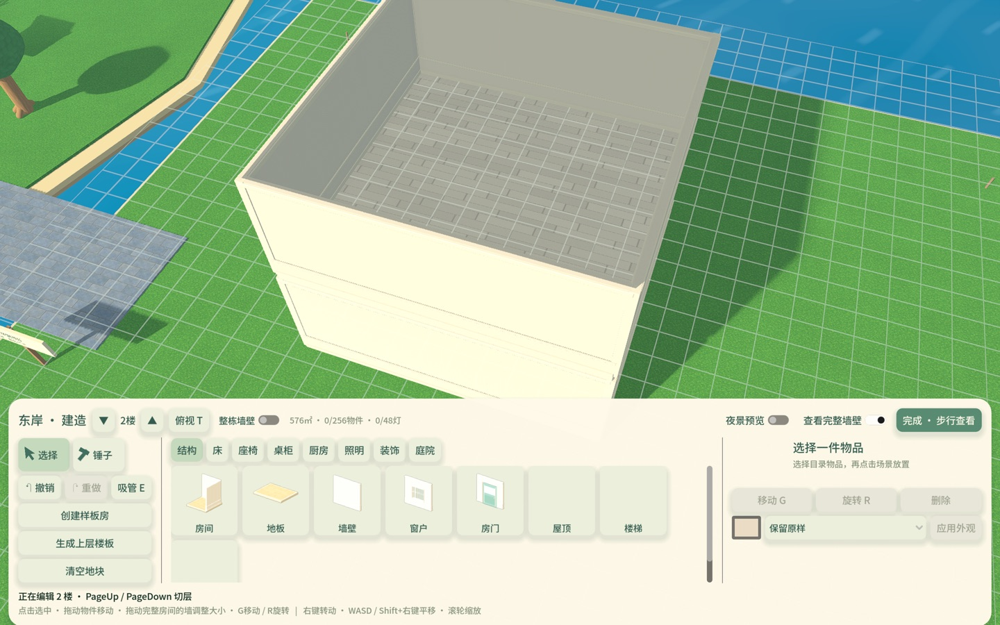
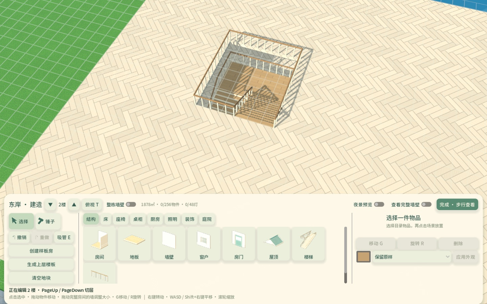
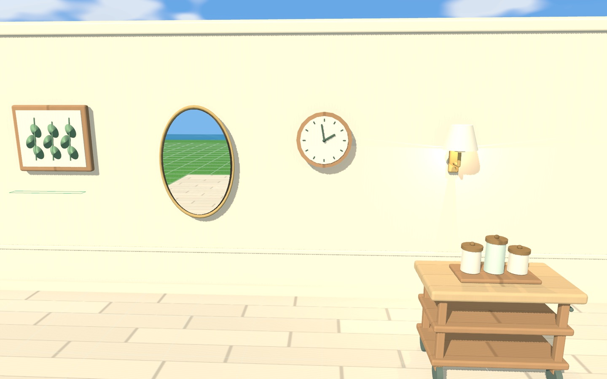
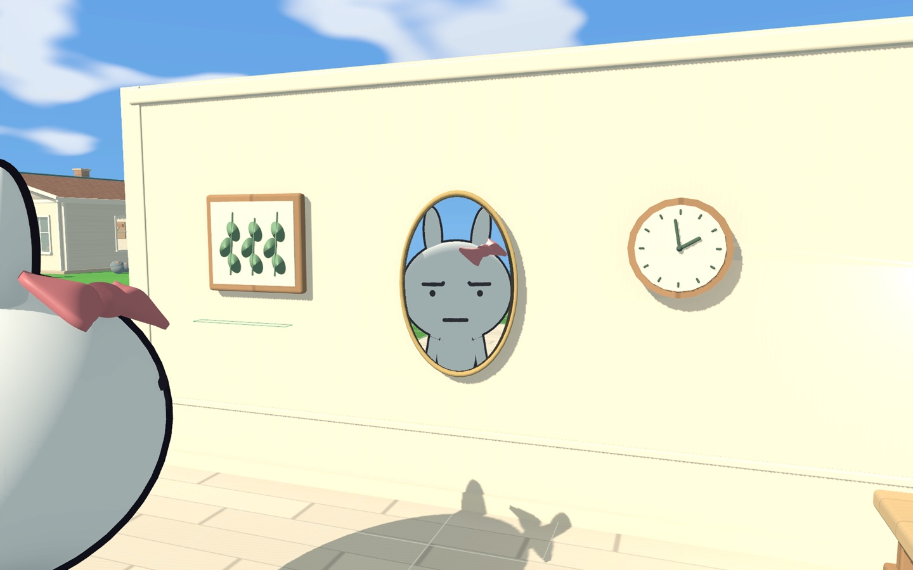
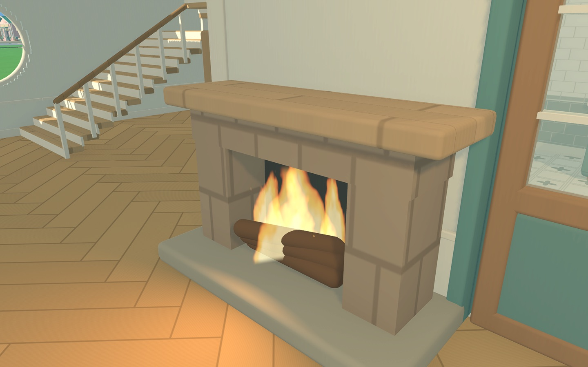

# 下层墙、楼梯出口与墙面陈设验证

2026-11-06。修改已进入本地源码，正式安装版仍为0.3.3/build6，本轮未部署或发布。除用户指定的东侧房屋壁炉位置调整外，测试均使用隔离进度。

后续收尾仅删除无调用的辅助代码、无用状态及计时缓存，4组相关检查重新通过；当前源码哈希与清理范围见[交接记录](evidence/handoff-20261106/summary.json)和[整理清单](整理清单.md)。下文22组为本功能阶段的固定证据。

后续已修复隐藏屋顶截住完整墙模式选取，并合并墙体开关、取消镜面18米阈值与低频轮流刷新。下面的双镜预算、距离和计数为历史实现，墙体选取修复与阶段双镜对照见[后续墙体验证](墙壁选取与镜面同步验证_2026-11-06.md)，当前多镜面行为及未完成项见[多镜面验收](多镜面反射优化与验收_2026-11-06.md)。

## 本轮结果

- 二层及以上打开“查看完整墙壁”，同时显示当前层和下层墙、门窗、墙体收边、护栏及楼梯；上层仍隐藏，鼠标选取仍限当前编辑层。
- 本栋上层完全没有地板时，首座楼梯按下层房屋轮廓补齐上层楼板、保留楼梯洞；已有楼板时只补缺少的落脚区域。其他房屋的上层地板不影响判断。真正悬空边保留护栏，通往地板的出口保持开放。
- 壁炉按实际底座和后沿吸附，背面与墙面保留1厘米净隙。更新后的双层样板来自本机最东侧房屋，包含调整后的壁炉。
- 新增3款挂墙装饰：林叶植物挂画、黄铜椭圆壁镜、橡木挂钟；新增暖光黄铜壁灯、落地橡木厨房收纳推车、可摆台面的陶瓷调味罐托盘。目录现为44种物件、129个外观部位。
- 建造底栏内的双指滚动和连续滚轮只翻目录，捏合不改变相机距离；滚至底部、底栏空白或外观面板时，操作也不会穿透到相机。小数滚动量累积，场景区缩放保持原操作。

原先楼梯自动生成的3×3米孤立平台三侧有护栏，视觉上像封闭围台。本轮先用角色实走确认原平台出口可通行，再改进首座楼梯的完整楼板体验。已有旧屋顶挡住楼梯时仍提示先生成上层楼板，不静默删除屋顶。

挂墙物件自动朝向墙面，可用鼠标放置和直接拖动调整位置、高度；校验整幅物件的墙体支撑、楼层、门窗及其他物件冲突。墙体材质分段不会误判为支撑中断，整面墙扩缩带动物件，拆除支撑墙联动清理。壁灯是真实局部光源，计入现有灯光预算。厨房推车为独立落地物件，其台面也可承载调味罐等摆件。

## 真实存档与样板

操作前创建`user://island_city_v2.json.pre-hearth-20261106.bak`，保留原有`.bak`。真实存档196条布局中，仅`build_169`壁炉的`position`从`[140.2,9.925]`改为`[140.2,9.58]`。调整前后完整结构比较确认：其他布局、角色、经济、时间、设置、世界字段与一次性迁移标记均相同。收尾再次只读核对，结果一致。

随后从东侧房屋范围X=131～147、Z=2.5～17.5提取87条建筑记录，更新`data/building_templates/two_storey.json`；不包含角色或世界进度。四种旋转通过校验，实际构建后的壁炉碰撞后沿与墙面净隙通过检查。旧世界一次性迁移用的`templates.two_storey()`保持原基线，玩家目录读取更新后的JSON。

调整前存档SHA256为`94e5ae65197f29c1e1abd51d418e37ff790a70a90b2d2b24f2b015f47e00541c`；调整后为`b7be34f0174e3b87c2e14cd7dcdcf9c77d6cd10a6ff508a01c759d5d48a417fc`。固定证据只保存改动说明及哈希，完整玩家存档和备份留在本机私有目录。

## 真实镜面与开销控制

壁镜使用共享3D世界的平面反射视口，反射相机随观察位置变化，并用非对称视锥匹配镜面四角。可反射主相机背后的角色和物件，包含角色正面，测试同时核对真实像素与投影边界。镜面不参与互相反射，避免递归。

最多两面可见近镜分配实时视图；按屏幕面积优先，18米外、背向、被挡或离开画面的镜子停止额外场景绘制。纹理高度按投影面积选192、384或640像素，2×MSAA；反射视图关闭SSAO、SSIL、SSR、辉光和局部灯光阴影图集。静止时总更新预算最多30次/秒，镜头位置移动时最多60次/秒；两面镜子共享预算。其他镜子显示材质高光，不具备实时局部场景反射。反射环境同步昼夜环境色和曝光。

实现入口为`city/mirror_reflections.gd`和`assets/shaders/planar_mirror.gdshader`。镜面材质独立于外观染色，复制物件不会共用另一面镜子的反射图。没有改动全局画质档位。

## 验证与固定证据

22组相关测试通过，共2805个计数检查，包含既有回归，不能理解为独立功能数量。原始日志、截图、源文件与日志哈希见[summary.json](evidence/walls-mirrors-20261106/summary.json)。固定记录选择每组最新通过结果，未将中间失败或旧版结果计入通过。

| 测试 | 本轮覆盖 |
| --- | --- |
| wall_furniture_rules · 78 | 挂墙支撑/开口/高度/楼层/冲突，分段墙绑定、移动/拆除联动、厨房落地与台面依附、样板及壁炉贴墙 |
| wall_furniture_flow · 26 | 2～4层完整墙切换、六件真实模型、鼠标挂墙和垂直拖动、主相机背后物件真实反射、投影边界/双镜预算/远背向停止、角色镜像、实际样板壁炉碰撞净隙 |
| storey_extension_rules · 242、storey_extension_flow · 132 | 首座楼梯铺本栋完整上层地板、已有地板补缺、独立房屋、材质/开洞/护栏、确认/取消/撤销和上层楼板工具 |
| stairs_first_walk · 36 | 直/L/U三种楼梯、各四个朝向，真实角色上楼、走入出口外3米的上层楼板、再下楼 |
| building_ui_scroll_flow · 10 | 双指上下滚、微量累计、连续滚轮、UI内捏合、空白/底部拦截，以及场景区双指/滚轮/捏合缩放 |
| stair_preview_performance · 3 | 240㎡楼板预览网格复用、有界缓存与预览无碰撞 |
| 其余15组 | 完整性429、控制34、相机/模板规则1313与图形57、表面9、房间鼠标22、外观200、灯光8、壁炉边缘4、建造存储14、多层编辑31与持久化10、用餐26与桌椅规则51、目录小图70 |

本轮还修正餐桌两端餐椅吸附朝向，规则检查实际朝向桌面，原用餐流程回归通过。

```sh
python3 tools/dev.py test --suite building_walls --windowed --timeout 240
python3 tools/dev.py test stairs_first_walk stair_preview_performance --windowed --timeout 240
```











## 性能口径与边界

首座楼梯预览复用楼层拓扑及4米分块网格，楼层拓扑缓存最多4项，网格缓存最多384项，布局变更后失效。避免鼠标每次移动重新生成整块楼板网格；预览不生成物理碰撞，不写存档。

240㎡封闭房间、12次热态移动的无界面CPU计时：首次26.269ms，热态中位8.101ms，最大11.828ms，保留40个共享块。仅包含规则和预览几何计算，不含GPU绘制、完整提交或写盘，不代表游戏帧率。该性能测试已在采样前停止无关音频并等待音频服务器释放，最终退出无资源残留提示。所有归档日志均无脚本/着色器错误或退出警告。

图形验证为本机Mac、Godot4.6.3、Metal Forward+，截图已人工查看。未覆盖Windows实机、满四层同时叠加各容量上限、长期会话或完整多人回归；镜面预算是开销限制，不是所有场景稳定60FPS的承诺。
