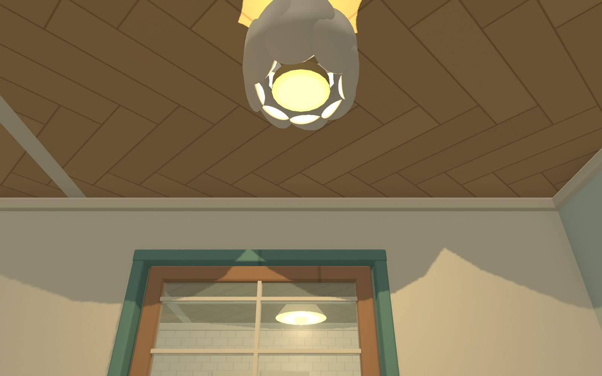
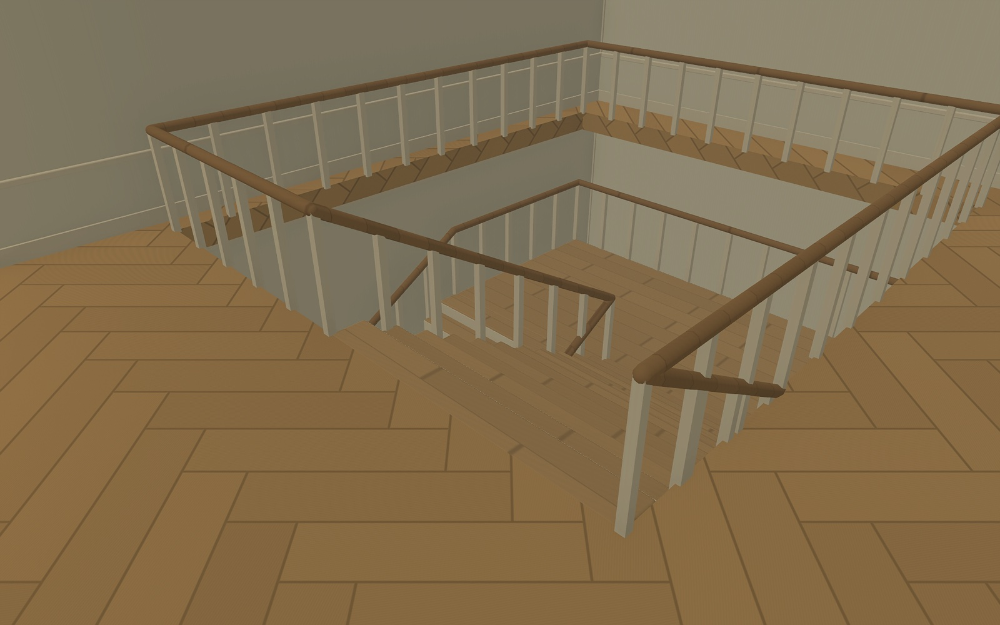
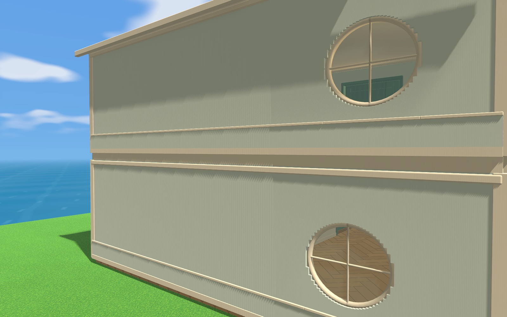

# 多楼层显示与拼接修复验证

2026-11-05，Godot 4.6.3，Mac Metal / Forward+。对应[五项玩家反馈](待修问题_多楼层显示与拼接_2026-11-05.md)。仅源码修复与相关验证，未部署发布，未运行完整回归。

## 复现与修复

修复前以隔离测试进度加载实际成品地图，并放置同一 `templates.two_storey()`。第一版专项611项中71项失败；实际帧可见一楼/楼梯上方天空，以及远端海面整批消失。修复前后截图采用相同世界坐标；最终截图隐藏HUD和角色，便于检查建筑。

- M01：海面材质所对应的批次禁用距离剔除；旧成品地图在加载时修正，生成器同步修正。相机X=140、146、154、165均验证真实水面像素。
- M02/M03：自由完整/自由避挡保留上层结构，自动俯视保留遮光代理；切换模式能恢复楼板可见性。检查真实帧天空像素、屋顶阴影代理、普通天花与楼梯洞上方的实际相机限高；保留三种视角的白天/夜间截图。
- M04：井沿护栏独立归属上层显示，竖杆两端连接收紧。直/L/U与0/90/180/270度共12组，用实际生成的安全栏碰撞端点向下探测楼板、平台和斜段支撑；探针在立柱足迹内微移以避开旋转后的零面积三角形边缘。
- M05：楼板恢复可见，并在上层墙下增加0.302米封边，填充0.30米层间带，与上下结构各相交1毫米，避免共面闪烁。六处外墙层间带横向射线命中实体封边，检查内外截图。

## 本轮执行

| 检查 | 结果 | 范围 |
| --- | --- | --- |
| `multistorey_repairs` | 651项通过 | 显示/模式恢复、天空与海面像素、相机限高、封边碰撞、12组楼梯支撑及昼夜截图 |
| `multistorey_editor_flow` | 31项通过 | 楼层选择、预览/取消、真实开洞、撤销重做、整栋外观 |
| `multistorey_showcase_walk` | 21项通过 | 样板房上下楼、房间与阳台实走、厨房与座椅入口 |
| `multistorey_flow` | 32项通过 | 三物种/三种楼梯上下行、4楼往返与编辑显示 |
| `multistorey_performance` | 6个视角场景及3种楼梯预览完成 | 原固定布局兼容副本，90家具/15灯；不读取真实进度 |

完整日志摘要、截图索引和性能原始数据见[证据索引](evidence/multistorey-repairs-20261105/summary.json)。源码没有修改存档schema、迁移标记或样板房位置，未改真实存档，也未重新生成地图。最后仅对封边微量交叠重跑修复专项；此前实走检查对应同样的显示/护栏逻辑，封边厚度为0.300米。

## 性能短测

实际窗口3024×1890，3D比例0.592，4×MSAA，关闭帧率限制与垂直同步。每场景约2秒动态视角；下表是完整帧耗时，不是仅CPU提交时间。

| 楼层 | 模式 | 帧中位ms | P95 ms | 绘制调用中位 |
| --- | --- | ---: | ---: | ---: |
| 一楼 | 自动俯视 | 12.777 | 13.242 | 1143 |
| 一楼 | 自由完整 | 14.481 | 19.992 | 1868 |
| 一楼 | 自由避挡 | 16.628 | 22.162 | 2105 |
| 二楼 | 自动俯视 | 13.596 | 13.894 | 1236 |
| 二楼 | 自由完整 | 15.527 | 17.262 | 1783 |
| 二楼 | 自由避挡 | 17.600 | 23.068 | 2037 |

自由模式需要保留上层外壳及屋顶投影，绘制成本不能与缺失几何时等同。仍按楼层裁剪家具，显示缓存只在楼层/模式变化时更新，不逐帧重建网格。短测不代表复杂布局稳定60FPS；未覆盖Windows实机、长期编辑、全部容量组合或发布验收。

## 固定截图

修复前远端海面消失：

修复后海面：

一楼自由完整天花：

楼梯井护栏与支撑楼板：

外墙层间封边：

