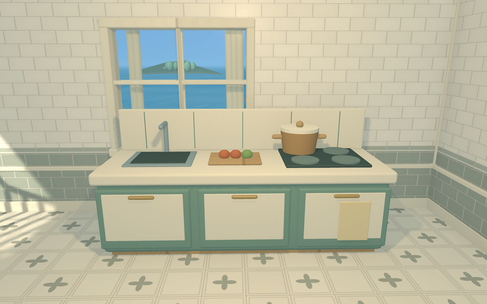
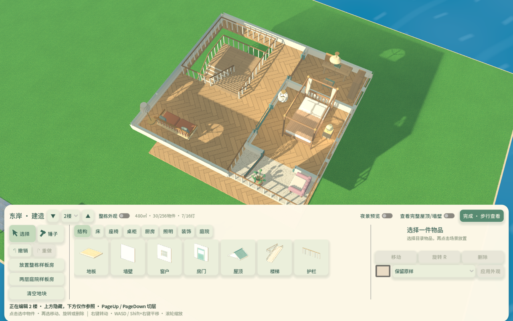

# 多楼层验证与性能 · 2026-11-05

当前源码实现1～4楼、直线/L形/U形楼梯、逐层建造与240㎡两层东庭样板房。只提交推送源码，未部署、发布或导出；正式版本仍为0.3.3/build6。操作、结构规则和容量见[建造模式](建造模式.md)，本页维护本轮验证与性能口径。

## 交付与验证

样板房占地16×15米，是原120㎡样板房的两倍，位于东岸(139,10)。一楼客厅与厨房，二楼卧室、书房与露天阳台；U形楼梯连接两层。厨房新增可实际烹饪的青瓷料理台，地面采用鼠尾草花砖，墙面采用奶油青瓷釉砖；料理台和两种纹理均可独立从建造目录选用。正常游玩由角色步行上下楼，建造时用楼层下拉或PageUp/PageDown选择编辑层。

验证使用Godot4.6.3/Mac/Metal Forward+与隔离测试存档，共24组功能检查，另有6个相机性能场景和3种楼梯预览计时。各组最终日志、检查数、截图、源码哈希与边界保留在[固定记录](evidence/multistorey-20261105/summary.json)，不是完整项目或多人回归。

- 三物种分别实走直/L/U楼梯上下，另实际连续走通1楼→4楼→1楼。踏步使用连续坡道碰撞，平台转角和上层开洞均经过物理通行检查。
- 样板房用最大体型兔兔从正门走上楼，按E打开书房/卧室门，绕床到阳台、坐下并起身，最后下楼进厨房。床与阳台家具位置按这条真实路线调整；室内门初始关闭，避免门扇挡住回廊。
- 实际E键验证上层床/座椅、同层起身、错误楼层和楼梯半途高度拒绝；料理台沿用原配方并实际扣材料、产出料理。楼上状态与构造通过真实隔离检查点/完整保存重载。
- 实际编辑控件验证切层、2楼选取/装修/新物件选中、门窗确认前预览、三种楼梯子目录、临时开洞、取消/撤销/重做。人在楼梯上或楼上时，阻止拆改所用楼梯、脚下地板或唯一的下楼结构通路。
- 原建造网格、修订、存储、外观、鼠标/退出、门窗、坐卧、隔墙对话、生产和项目完整性运行相关回归。原环境音/火光检查通过；其日志仍有已知的原生Variant资源池退出诊断，无脚本或着色器错误。新的多楼层图形用例退出日志干净。

当前本机布局仅只读复制至被Git忽略的私有QA目录。兼容检查保留原96条规范化记录，添加样板房后167条；家具60→90、灯8→15，均在全岛统一预算内。只发布[兼容统计](evidence/multistorey-20261105/compatibility.json)，不提交原存档。收尾再次核对真实布局与只读副本相同，未直接写入真实进度。样板房在下次正常进入单人城镇时经原子检查点增量添加；重复进入不重复生成，清空地块保留标记，预算或位置冲突时保留旧布局。

## 性能实测

设备Apple M1 Pro，Godot4.6.3 Metal Forward+，输出3024×1890，3D缩放约0.59155（约200万3D像素），4×MSAA。关闭VSync和帧率上限，每场景预热后短时转动镜头并轻微移动，采样2秒。布局为当前旧布局加样板房，共90家具、15灯、719.75㎡原始地板（含楼梯派生开洞前面积）。

记录`frame_post_draw`完整帧间隔，包括提交/同步；CPU提交计时不是独立GPU耗时。系统负载和其他本地进程可能影响结果。6场景共820帧，不能据此保证全游戏或任何设备稳定60FPS。

| 楼层/相机 | 中位帧耗时 | P95帧耗时 | 中位绘制调用 | 其中阴影调用 |
| --- | --- | --- | --- | --- |
| 1楼 自动俯视 | 12.497ms | 12.931ms | 1039 | 857 |
| 1楼 自由完整 | 14.209ms | 20.046ms | 1735 | 843 |
| 1楼 自由避挡 | 16.095ms | 21.584ms | 1920 | 936 |
| 2楼 自动俯视 | 13.587ms | 13.930ms | 1222 | 1003 |
| 2楼 自由完整 | 15.483ms | 17.351ms | 1761 | 894 |
| 2楼 自由避挡 | 17.565ms | 22.786ms | 2025 | 976 |

原始数据见[performance.json](evidence/multistorey-20261105/performance.json)。两层三种模式都受实际可见物件、阴影和像素量影响；自由避挡场景负担仍较高，2楼默认模式中位耗时已超过16.7ms预算。此表没有与旧房间不同构图的测试直接换算改善百分比。

楼梯鼠标移动预览另用当前布局加两片空楼板，逐种移动24次，首次单列，后23次统计热预览。优化前[同类计时](evidence/multistorey-20261105/preview-before.json)中位62.33～65.31ms、首次307～341ms；最终如下：

| 造型 | 首次预览 | 后续预览中位 | 后续P95 |
| --- | --- | --- | --- |
| 直线 | 80.860ms | 7.398ms | 8.173ms |
| L形平台 | 104.556ms | 8.235ms | 8.326ms |
| U形折返 | 110.680ms | 8.287ms | 8.857ms |

首次仍有网格生成/上传尖峰；热预览显著缩短不代表所有操作都低于一帧。

## 本轮处理与后续空间

楼梯踏步、扶手直接合批为少量网格，复用倒角几何与原型，避免先创建大量临时高细分节点再合批。开洞按楼梯包围范围删除半米格，缓存各层网格与楼梯占地区域；移动预览先检查局部结构，确认时再走完整布局验证，避免每次鼠标移动重复压缩和扫描整块地面。

楼层/视角可见性以缓存节点列表更新，未变化时不重复写材质；上方几何隐藏后同时从镜头探测排除，角色碰撞保留。当前层下方被楼板覆盖的室内家具与灯光不参与显示，楼梯洞内仍需看见的物件保留，紧贴上方楼板的天花投影继续保留。原有火光仍采用节流参数变化，不增加动态阴影灯。

后续可优先测量阴影更新与GPU成本，减少远处室内物件/灯的阴影范围，进一步合批重复家具和结构。首次楼梯预览可分帧预热；极端布局的完整验证、网格压缩和保存仍可进一步增量化。应固定设备、分辨率、存档、视角与负载做配对实验，再决定画质取舍。

当前NPC继续使用地面导航，没有新增上楼作息。Windows实机、长期压力、满四层全部容量上限同时叠加、多人建造和完整多人回归不在本轮验收范围。

