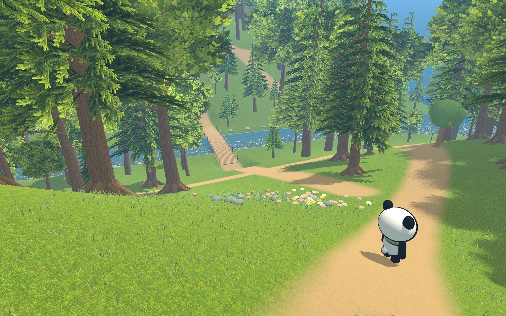
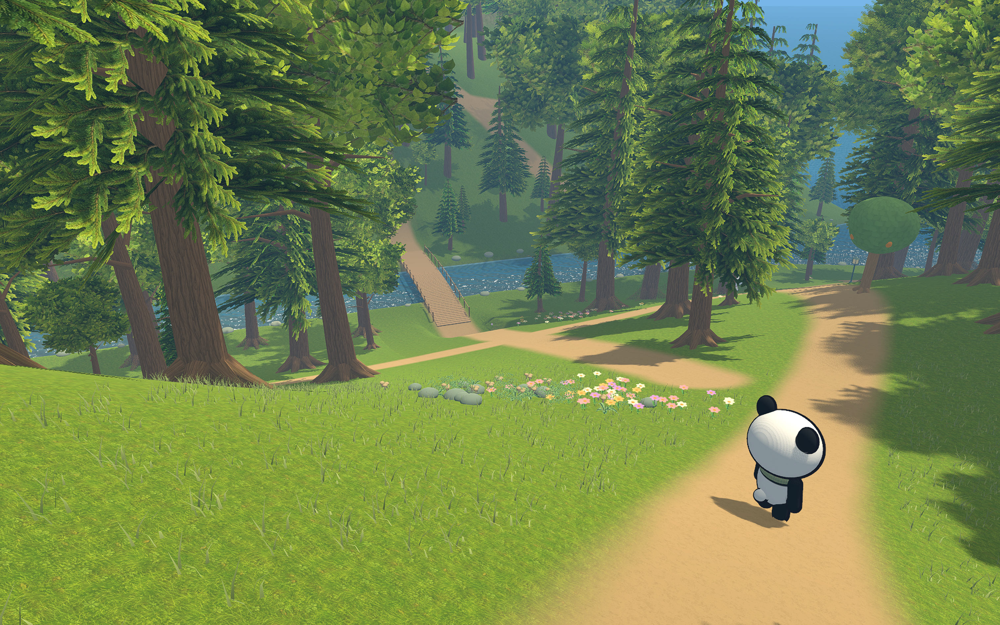
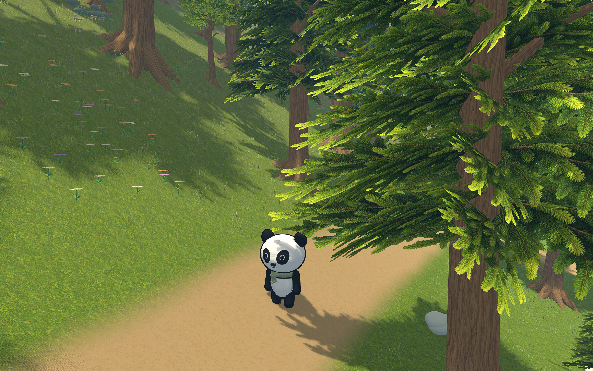

# 山谷自然光影与性能优化

后续状态（2026-11-18）：相关修复已随0.4.2正式发布部署，见[当前发布与清理记录](0.4.2_发布与清理记录_2026-11-18.md)。下文保留当时阶段记录。

后续修复：此轮较小的阴影偏移在角色曲面上产生波纹，已由[角色波纹阴影修复](角色波纹阴影修复_2026-11-17.md)校正；下述数据保留本阶段时间点结果。

2026-11-17，基于`73e1167`继续开发。**只更新并推送源码，没有发布、导出安装包或部署**；正式版仍为0.4.1/build8。前一轮[兔子停步修复](山谷NPC停步修复与显示距离说明_2026-11-17.md)保留。所有游戏验证使用隔离数据，未读取、重置或覆盖真实玩家进度。

## 本机试玩

双击`tools/本地山谷预览.command`，直接进入独立的山谷测试角色。沿山路看远处树林、到树下转动视角，检查投影和过渡。Esc设置底部“保存并退出游戏”退出。联机可用`tools/本地双人建造测试.command`后各自乘船到山谷；它会启动本机源码的隔离服务器。普通F5使用真实进度，连接正式服不会应用尚未部署的NPC服务器修复。

## 树影随角色变化的原因与修复

果树沿用的`occlusion_fade`与`tree_bark`材质，把角色避挡的`opacity`同时用于主画面和光源投影。角色走近树时，树冠/树干让开视线，投影也跟着消失；这与真实的微风摆动不同。旧近景树在约67米切成无投影远景树，也会改变地面明暗。

现在避挡先判断当前是否为场景相机视图，光源视图保留完整树木。新增GPU画面对照覆盖太阳、点光和聚光，以及树冠/树干两类材质；强制刷新局部光源缓存，避免旧缓存掩盖问题。旧代码六种组合均出现投影变化，修复后六种组合测得地面投影像素变化均为0，主画面仍能避挡。

山谷大树还新增独立投影实例：使用固定的简化树形，保持风动，不受可见模型的远近切换或主镜头避挡控制。它属于投影近似，并非额外渲染完整精细树木。太阳方向在半秒时钟刷新之间平滑变化，消除原先直接更新方向造成的小跳动。现有昼夜速度、时间与NPC作息不改。

## 光影和显示范围

| 内容 | 本轮结果 |
| --- | --- |
| 树木细节 | 每棵树按自身根部到相机的距离，在64～104米间互补渐变；粗略批次裁剪留足范围，远处树林轮廓不再在245/320米直接切掉 |
| 过渡方式 | 静态交错噪声覆盖，保留不透明裁剪管线；没有透明排序或额外场景相机；避免4×4棋盘格在空间放大后过于明显 |
| 草 | 32～54米逐渐收拢整簇草叶，避免只压低高度后留下平面碎片；批次到最近草叶完全消失后才裁剪 |
| 林下细节/花/河岸植物 | 58～86米渐隐，城镇与玩家花园默认不启用这段距离渐隐 |
| 树影 | 太阳范围100→160米，112米起渐隐；独立投影不再随67米可见模型切换消失 |
| 阴影分区 | 使用实测后的两个分区，近区约35.2米，开启分区混合；保留项目默认阴影贴图尺寸 |
| 光线 | 低太阳位置更暖，中午偏自然白，天空补光略冷；太阳角直径设为0.53，调整阴影软度/偏移，增强树下层次，远景薄雾减轻；保留可读的月光与三盏路灯 |

## 性能处理与测量边界

可见树的空间格从24米合并到48米；投影按四个大区域和四种原型合并，避免每个小格被所有阴影分区重复提交，也避免把整个森林提交给每个近处分区。远山实例分组减少。树干、叶片和草网格生成共享索引，保留既有法线；草叶从三段减为两段，减少三分之一的三角形，改为整簇共用风相位/距离计算。投影采用更简洁的树干和叶片网格。只有近景两份避挡材质需要逐帧写入焦点和镜头位置，其他材质不再重复写入。

**没有降低均衡档的约200万3D像素预算、MSAA、UI分辨率或帧率目标。** 图形检查顺序运行。M1 Pro/Metal/Forward+，3024×1890输出、3D比例约0.592：12秒快速穿行并转镜头平均60.08FPS，P95为19.52ms，最长21.29ms，超过50ms为0帧；七处昼夜场景P95为18.67～20.37ms。

另用相同固定取景、相同像素预算关闭帧率上限，每处预热1秒、采样2秒，比较四个有效配对视角：

| 视角 | 绘制调用：修改前→后 | 帧耗时P95：修改前→后 |
| --- | ---: | ---: |
| 林下正午 | 637→414 | 11.29→11.51ms |
| 山腰俯瞰 | 1004→957 | 11.87→14.17ms |
| 溪桥 | 917→821 | 13.54→13.31ms |
| 小屋夜间 | 640→516 | 13.21→13.03ms |

这些配对测量对应同一套最终渲染源码。绘制调用减少约5%～35%，但更远、更完整的树影和可见细节仍有成本，俯瞰视角耗时上升约19%，不能写成所有场景都加速。该测量报告的总渲染显存约503.45→514.77MiB，包含帧缓冲和缓存，不是树木独占内存。最初晨光取景镜头落入坡内，已从配对比较排除；测量脚本改用独立标识的安全晨光视角，仅记录当前结果。短时本机结果不代表原生满分辨率、其他硬件或所有长期负载。

## 验证与保护

[固定汇总](evidence/woodland-lighting-20261117/summary.json)保存日志、基准JSON、源码哈希和实机截图。本轮15组功能/性能检查通过，报告1,291项计数检查，另有固定视角测量；覆盖GPU过渡无缺口、三种光源投影稳定、太阳连续/晨光/室内补光、场景结构、相机与栈道、兔子脱困/作息、双人联网往返/采集/对话、城镇室内昼夜稳定和远端移动缓冲。没有放宽既有性能检查阈值。

重建地图前后607个碰撞节点（含空形状占位）的类型、参数、世界变换、碰撞层/掩码与地形三角数据指纹一致；271棵近景/幼树、220棵远山树、36,728簇草、500朵野花及小屋蓝图一致。地图坐标修订仍为2，资源ID、角色、存档和时间约定保持不变。未改小屋资源，生成器的等价重存已还原为原字节。

```sh
python3 tools/dev.py doctor
python3 tools/dev.py test --suite woodland_lighting --windowed --timeout 240
python3 tools/dev.py test woodland_lighting_benchmark --windowed --timeout 180
```

真实联网用例另需[隔离账号服务](服务器运维.md#本地多人和更新测试)。GL地图生成器退出时仍有两条各21,844字节的既有纹理清理提示；不能写成零引擎诊断。未验证Windows实机，未改变正式服务或下载内容。

依据：[Godot投影视图与主相机矩阵](https://docs.godotengine.org/en/4.6/tutorials/shaders/shader_reference/spatial_shader.html#vertex-built-ins)、[不透明抖动过渡](https://docs.godotengine.org/en/4.6/tutorials/3d/visibility_ranges.html#use-dithering-for-lod-transitions)、[太阳阴影范围和分区](https://docs.godotengine.org/en/4.6/classes/class_directionallight3d.html)。

## 实机画面

修改前：



修改后：




