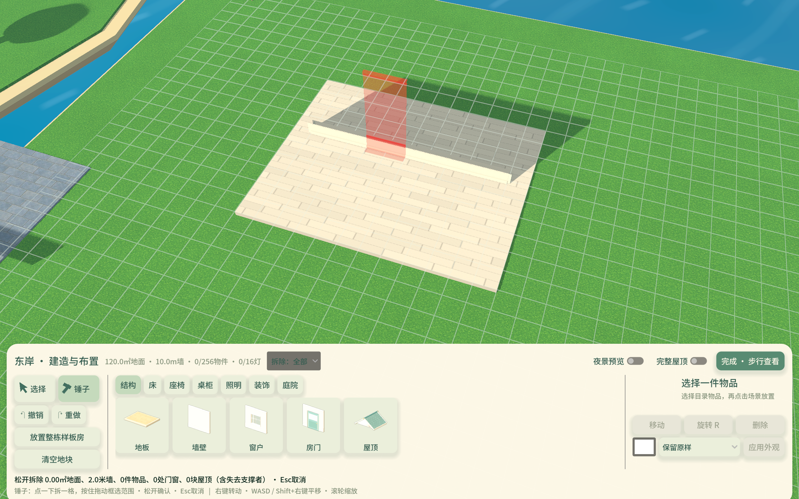

# 建造模式 · 本地单人版

2026-11-05。当前源码可用，正式服和安装包仍为0.3.3/build6，以下功能尚未发布。

## 进入与目录

Godot打开项目，F5进入**单人城镇**，按 **F6** 或点击底栏“建造”，进入城镇东岸建造园。所有工具与操作集中在底部，上方保留场景；相机取景按面板上方的可见区域居中。

底部依次为选择/锤子、撤销/重做与样板房工具，分类目录，以及当前选中物件的小图、名称、移动/旋转/删除和分部位外观操作。目录分为**结构、床、座椅、桌柜、厨房、照明、装饰、庭院**，缩略图由实际模型离屏渲染并缓存，不是占位色块。选择地板、墙、门窗或屋顶工具时，右侧详情也会显示对应小图。缩略图相机不使用物理插值，等待完整绘制并校验图像，避免大物件切到小物件时过小、截断或空白；空图会重试。

“放置整栋样板房”会拿起一栋12×10米的房子，跟随鼠标预览，点击空地放下。已有房屋可以保留，允许在同一地块摆放多栋；冲突时模型叠加红色提示，不能落下。放置后墙边、地板单元、家具与摆件仍可独立编辑，整屋放置可一步撤销。

从空地开始：

1. 在“结构”中选地板，点击矩形两个角。
2. 选墙壁，点击线段两个端点；墙沿网格建造，初始两面相同，放置后可分别装修内侧与外侧，画线方向不改变墙面归属。
3. 选房门或窗户，进入造型子目录，选款后点击墙面形成真实开口。
4. 选屋顶并挑选造型，点击覆盖地板的矩形两个角。
5. 在其他分类选择家具或摆件，点击场景放置；台灯、小摆件自动吸附到桌柜或书架层板，吊灯吸附到屋顶或上一层楼板的天花板高度。
6. 点击物件选中，再使用底部操作；双击可直接拿起移动。完成后点击“完成 · 步行查看”。完成按钮、Esc和F6退出均保留玩家当前位置，并同步跟随相机与存档。

## 多楼层与东庭样板房

现在支持1～4楼，层间距4.7米，净墙高4.4米。正常游玩由角色实际走楼梯上下楼，镜头平滑跟随高度，建筑按脚下楼层自动显示；没有手动切换游玩楼层的按钮。楼梯途中有楼层切换缓冲，避免画面来回跳变。

建造底栏用“▼／楼层下拉／▲”或PageUp/PageDown精确选择编辑层。只有当前层可以选取、放置、装修或拆除；上方隐藏，下方地面与连接楼梯保留参照。切层取消未确认的预览，不移动角色。“整栋外观”一次显示所有楼层和屋顶，关闭后恢复原屋顶选择；外观查看期间仍只编辑选定楼层。

先铺好上下层地板，再在下层“结构→楼梯”选择直线、L形平台或U形折返。R旋转，点击放置。三种均为3米宽实体楼梯，24级踏步、约19.6厘米级高；L/U形中间有休息平台。预览标出上下层入口，完整建筑视图还预览真实楼板开口。楼梯自动开洞与生成护栏；移动、删除、撤销同时更新开口，原先手动拆除的地面不会被填回。出入口需有3米宽落脚区，并避开墙、护栏、家具和下层旧屋顶。

在原屋顶上方完整铺一层地板，会以楼板替换旧屋顶并保留仍有支撑的吊灯；局部扩建与旧屋顶相交时，需要先调整旧屋顶。上层楼板的底面作为下层天花板。家具、台面摆件、门窗、吊灯各自属于所在楼层。坐卧与料理在发起时复查距离和楼板/墙体阻隔；起身留在原楼层。角色正在楼梯上时不能拆改该楼梯；人在楼上时不能拆掉脚下地板或唯一的下楼连接。

单人东岸实际地形扩为104×42米，可编辑区为98×34米：X=61～159、Z=−7～27。旧地图加载时补齐实体地形，原房屋坐标与原进度保留，地图与海岸环境声同步扩展。首次正常进入单人城镇，会在(139,0,10)附近添加一次可拆改的**16×15米、占地240㎡**两层样板房，正好是原12×10米样板房占地的两倍；东侧再留12米可建造余地。样板房使用U形楼梯，一楼是客厅、厨房和楼梯厅，二楼是卧室、书房、楼梯回廊，卧室玻璃门通往露天阳台。家具共30件、灯具7盏，仍计入全岛统一预算。已有本地布局96条记录的只读副本已核对可并存，未直接改写真实存档；正常进入游戏时通过原子建造检查点添加。清空地块会保留“已添加过”标记，避免样板房重新生成。预算或位置冲突时保留旧布局；目录中的“两层庭院样板房”可手动选址放置。

“厨房→青瓷料理台”可独立建造、移动、旋转、染色。靠近实际操作位按E，沿用原7种料理的配方、技能、耗时、材料与结算；蒸汽跟随当前使用的料理台。操作位被堵、隔墙或隔楼板时不能开工。厨房使用新增“鼠尾草花砖”地板与“奶油青瓷釉砖”墙面，两种都加入结构材质选项，采用抗锯齿程序纹理、世界坐标连续铺贴，无新增大幅位图。

现有NPC漫游继续使用地面导航，不新增NPC上楼作息；地面导航不会把上层楼板误采成街道，避开楼梯区域。玩家真实步行不受这项NPC路径约定限制。

## 操作

| 操作 | 输入 |
| --- | --- |
| 进入/结束建造 | F6／底栏“建造”／完成按钮 |
| 放置或选取 | 鼠标左键；双击选中物件直接移动 |
| 单点拆除 | 先点“锤子”或B，再点目标；墙/地板只拆半米单元 |
| 范围拆除 | 锤子模式按住左键拖动，松开确认；从墙开始只拆墙，从地板开始只拆地板，从物件开始只拆物件；Esc取消 |
| 删除选中物件 | 底部“删除”／Delete／Backspace |
| 移动物件 | 选中后点“移动”，再点新位置 |
| 家具旋转 | R／底部“旋转”；移动预览中也可旋转 |
| 撤销、重做 | Ctrl／⌘＋Z，Ctrl／⌘＋Y；最多50步 |
| 取消当前工具 | Esc或右键单击；选择状态下Esc退出 |
| 选择工具 | 底部“选择”／H |
| 转动视角 | 右键拖动 |
| 平移视角 | Shift＋右键拖动或WASD，方向跟随镜头 |
| 缩放 | 滚轮；目录上的滚轮用于目录滚动 |
| 查看完整屋顶/墙壁／夜景 | 底部开关；完整视图关闭墙顶剖切；夜景预览不修改世界时间，退出后恢复正常光照 |

预览显示真实模型和材质。合法位置保留物体外观，冲突位置在模型上叠加红色；家具只额外显示薄占地标记，不使用遮住模型的大色块。选中物件有高亮和范围提示，锤子模式用红色高亮将被拆除的目标及附属物。

结构、落地家具按0.5米网格吸附；靠墙时保存精确贴墙位置，台面物品按较细网格定位并限制在可用表面内。布局保存到毫米精度。移动完成（包括原位放回）后会恢复复用家具节点及附属物的显示；Esc取消同样恢复原物体。柜子、书架的墙面避让按实体范围处理。

## 造型与房间装修

结构目录中的房门、窗户、屋顶先打开子目录，各三款；“返回结构”回到上一层。地板、墙壁继续直接使用纹理选项。

| 结构 | 可选造型 |
| --- | --- |
| 房门 | 青藤镶板门、拱顶橡木门、花格玻璃门 |
| 窗户 | 十字平开窗、拱顶花窗、圆形舷窗 |
| 屋顶 | 双坡瓦屋顶、四坡檐屋顶、单坡采光屋顶 |

选中半米地板或墙壁后，“同房间同款一起修改”初始开启：应用颜色与纹理时只替换该房间中原颜色、纹理相同的表面，保留特殊花色和相邻房间；关闭后只改当前半米单元。未围成房间时只改当前单元。整次批量装修一步撤销。

墙面可选“内侧／外侧／双面”。内外按闭合房间识别，不随画墙方向改变；隔墙两边都有房间或尚未围成房间时，朝向镜头的一侧作为内侧。批量时分别匹配所选面的原颜色与纹理，不改另一面。新增暖木人字拼、奶油水磨石、铃兰花纹，地板与墙面均可使用；纹理使用世界坐标连续铺贴，无新增大幅位图。

## 新增布置物件

从现有室内造型拆出林间茶具组、田野手记、压叶标本画；另新增晨露陶瓶组、织篮与薄毯、月光风铃，花瓣软包椅，暮色褶光落地灯、白瓷花瓣吊灯，林间帷幔床、云朵软包床，蔷薇花拱门、睡莲小水庭。共新增13种物件；均有真实模型小图、放置预览、占地校验、碰撞/挂点及部位外观。月光风铃和吊灯依附屋顶或上层楼板，茶具、手记、标本画和陶瓶依附台面。

## 家具拆分、依附与照明

- 床、床头柜、台灯分别放置；书桌、椅子、信纸和盆栽分别放置；茶几、杯子和书本分别放置；书架与每本竖放书籍分别放置。床垫、抽屉等家具自身构件保留整体。
- 小物件记录承载物的稳定ID；书架另记录层板序号。移动/旋转桌柜或书架时，附属物一起移动/旋转。小物件也可独立移到另一台面。
- **删除承载家具时，上面的灯和摆件一同删除；一次撤销完整恢复。**删除屋顶且没有上层楼板继续支撑时，也删除其吊灯，删除墙壁也删除其门窗。
- 台灯、吊灯具有实际光源与阴影，落地灯、瓷瓣吊灯也发出真实灯光，照明随灯具的位置和数量变化；自建房已移除隐形的`RoomKey/RoomFill`。未放灯的房间只受正常太阳光和环境光照亮。预览物件不额外照亮场景；壁炉另有暖色真实聚光灯，照射范围5米，不生成动态阴影贴图，仅以20Hz轻微改变亮度（平滑包络约±26.5%），远处衰减，减少动效设置下保持稳定。固定住宅保留原照明，并共用火光节流逻辑。火光亮度采用平滑的约±26.5%包络，仍只在20Hz更新能量、不新增投影；交叉火焰不再穿过炉膛背板。立灯灯罩及细骨架不投影，灯体与其他家具保留正常阴影；室内灯具的远处投影和灯光使用引擎原生渐隐。
- 吊灯安装需要屋顶或上层楼板，隐藏屋顶后仍可选择和移动；所有建造座椅均可坐下；双人沙发、藤木长椅最多同时容纳两名角色，只有一个交互入口，自动分配空位，坐满时提示。木床、林间帷幔床、云朵软包床均可睡眠，三物种沿用共用睡姿与被子形变；重载恢复同一张床，起床检查真实地面与净空，床边无安全空位时保持睡眠并提示。

靠近床或座椅本身的可触及边缘即可出现E提示，检测随家具旋转与移动，不限定左侧；隔墙不能互动。按E坐下/睡觉后，再按E起身。优先回到交互前的位置，受阻时只在同一房间、无墙阻隔且脚部/身体/头部均有空间的位置起身；完全堵住时留在原位并提示。双人家具仍只有一个交互入口。

建造中角色、居民与世界进度暂停，水面等材质动画继续。当前免费试建，不扣材料或贝壳币。有效修改经Session校验、原子写入建造专用检查点，然后只更新发生变化的模型和碰撞；保存失败恢复旧布局与修订号。无变化的操作不写盘、不增加撤销记录。同岛角色共享布局，往返山谷不会丢失。

## 房门与当前范围

自建门及现有房屋门均允许在玩家站在门口时开关；**转动期间门扇和门洞阻挡临时关闭，允许模型穿过角色，停稳后恢复对应状态的正常碰撞**。仍禁止转动中重复切换，完成后刷新局部导航。工坊门默认打开。

建造只开放单人东岸98×34米地块；地板、墙体、楼梯不占家具名额，所有楼层共用下表预算。支持固定层高的1～4层、三种楼梯、直墙、门窗、矩形双坡／四坡／单坡屋顶和阳台护栏。已有城镇建筑、山谷与居民房屋不在编辑范围。多人建造、斜墙、屋顶自由编辑、建材经济以及水井/制造台的玩家放置仍待扩展；料理台已经可建造。

## 网格、房间与局部更新

墙以0.5米网格边、地板以0.5×0.5米网格单元编辑。单击选中的结构只对应这一小格，可移动、改色或删除。连续同材质墙合并成墙段，地板在4×4米块中合并同材质网格；同一直线上的接点没有装饰凸柱，实际墙端和转角才收边。存档保留合并矩形和墙段，不为每小格创建独立场景节点。

锤子没有拆除效果下拉框：按下鼠标时锁定目标类型，拖过其他类型也不会切换；从空白地面开始不会触发范围拆除。墙上的门窗随失去支撑的墙联动拆除，地板上的家具及其附属物按原有支撑规则处理。门窗和屋顶仍为单件点击拆除。锤子拖动先预览，松开后一步提交、一步撤销。预览列出墙长、地板面积、家具、门窗和屋顶的拆除数量，包含失去支撑的附属物。家具按完整占地逐格检查支撑，能发现原来九点采样漏掉的小洞；地板挖洞后悬空的家具及其台灯/摆件联动拆除。屋顶仍是矩形整体：失去地板支撑时会拆除整块屋顶，并在预览中计数；吊灯没有其他天花支撑时联动删除，仍有完整上层楼板支撑时保留。

门窗保存世界挂点，允许跨越不同装修的连续墙段；远处局部拆墙或改色不挪动门窗，破坏其所需墙边则联动拆除。移动结构需要满足完整依附/支撑规则，不允许产生悬空状态。

自动俯视与建造编辑使用下述房间遮罩；自由避挡按整面墙/屋顶模块隐藏，见室内视角。

房间由闭合墙边进行区域识别；门窗视为房间边界，拆开隔墙会合并房间，拆开外墙则连通室外。实际落脚处还必须有地板。屋顶按房间遮罩剖切，同一屋顶跨多个房间也只隐藏当前房间或遮挡镜头的部分；独立房屋不再一起隐藏。视觉剖切保留真实碰撞与投影。

每次提交仍保留完整规则校验，网格、空间索引、压缩和房间拓扑使用缓存；未受影响的4米地板块、墙段、家具与门节点均复用。移动家具只更新变换及依附物位置，灯光/门角度不重置。模型几何按类型缓存复用，地板直接合成网格。退出建造时只刷新发生变化的导航范围。

| 容量 | 当前限制 |
| --- | --- |
| 家具与摆件 | 256件，包含灯具与台面小物件 |
| 实际照明灯具 | 16盏，含壁炉，独立于总家具限制 |
| 墙体总长度 | 1,024米，即2,048条半米墙边 |
| 合并后的材质墙段 | 256段，控制密集碎片墙成本 |
| 地板 | 每层地块范围内最多13,328格，即3,332㎡；楼梯洞派生，不计作手动拆地板 |
| 楼层／楼梯／独立护栏 | 4层／16座／128段；楼梯自带护栏不占独立护栏名额 |
| 屋顶 | 128块，仍为矩形整体 |

容量压测和耗时见[验证记录](evidence/building-grid-local/summary.json)。本机满家具场景移动约31～36毫秒；极端满地块棋盘花色修改约0.33秒，仍可能短暂停顿。规则校验和建造检查点尚为全布局，模型与碰撞已局部更新；这些数字不代表所有设备的帧率。11-04本轮复测，满家具移动约26～31ms、极端棋盘改一格约288ms；仍不能承诺极端满格无停顿，完整数据见[本轮记录](evidence/building-expansion-20261104/summary.json)。

## 家具外观与室内视角

选中已放置物件 → 底部“外观 · 选择部位” → 选择部位、纹理与颜色 → “应用当前部位”。36种物品共111部位，例如床架/床单/被套/枕套分别编辑，家具本身仍是一件物体。布纹分别提供底色与花纹色，含格纹、花叶、条纹、波点和AI雏菊；原始有花纹的材质也能调第二色，纯色/木件隐藏无效选项。被套保留布面形变。

实时预览不保存，关闭或Esc取消；选部位仅短暂提示，调色时无持续绿层。支持恢复该部位、恢复整件和三套配色预设。右侧小图显示已保存外观，目录图保持默认样式。旧整件改色与旧双色对比度继续兼容，移动/撤销/保存包含部位覆盖。开发资料与扩充流程只维护在[外观与纹理开发](外观与纹理开发.md)。

右上角相机按钮只在室内正常游玩时出现，首次进入会提示；点击选择或按V循环，选择与提示状态记在本机设置，换角色/房间不重置。建造使用独立编辑镜头。

| 模式 | 镜头与建筑显示 |
| --- | --- |
| 自动俯视 | 室内抬高俯角，按房间剖切 |
| 自由完整 | 自由转动/缩放，墙与屋顶完整；镜头受真实墙顶碰撞约束 |
| 自由避挡（默认） | 不强制俯角，隐藏挡住镜头看玩家的整面墙；阻挡屋顶按模块处理 |

遮挡检测覆盖玩家头部/躯干等多个点，排除门窗开口，门扇按当前角度检测。同一直线上分段装修的连续墙一起隐藏，真正墙端收边随墙隐藏，其他墙和无关房屋保留；视线离开后短暂延迟淡入，减少闪烁。视觉剖切不取消角色碰撞、投影或真实灯光。

室内帧率还取决于真实阴影与渲染像素量，三种模式均可能受影响。11-04已去掉自建墙面未变化参数的逐帧重复提交，遮挡采样复用探测点并节流到约30Hz，淡入淡出继续逐帧。实际定位、优化幅度与后续方向见[室内灯光与性能排查](室内灯光与性能排查_2026-11-04.md)。

完整屋顶/墙壁视图下，门窗放置前按实际鼠标射线选墙，临时预览同造型的真实开口与模型；原墙碰撞保留，确认前不改布局或存档。取消、移到工具栏、切换屋顶视图或移动已有门窗时恢复旧墙/旧框，非法重叠只显示红色轮廓。靠墙书架和收纳柜也保留可见的放置轮廓。

壁炉背板与炉柱的后表面已错开，避免边缘共面闪烁；现有固定房屋在加载时修复旧网格，无需重新摆放或重建地图。该修复独立于火焰动画。

## 存档与维护

`build_layout`现为schema4，兼容schema1/2/3；缺省`storey=0`，1～4楼对应0～3。楼梯保存下层楼层、造型、位置和朝向，上一层开口从楼梯派生；`support_level`继续只表示书架层板，不借作楼层。门窗/屋顶可选`form`，门可选`default_open`设置初始开合（缺省沿用原先打开）；样板房的厨房/书房/卧室门初始关闭，以免打开的门扇横在通道中，靠近按E开关。墙面可选`faces.positive/negative`，均为增量字段；缺省仍还原原造型/原双面外观。旧布局未计入预算的既有壁炉会获得不扩大的照明容量兼容记录，删除后缩减，新放置仍受16盏限制。

外壳schema3与Authority schema2不变。旧schema2转为可拆改网格并合并连续结构，旧schema1还会自动拆分组合家具并按真实Y轴旋转保留位置；少数旧规则允许的几何冲突以精确几何签名保留，新放置不能借用旧冲突豁免。无法读取的布局保留`recovery_source`，不静默丢弃原记录。

此前本机布局在备份后由schema2的84条记录迁为schema3的83条记录，仅合并了一组连续结构，所有家具/屋顶、地板/墙的覆盖与材质、门窗世界挂点保持一致，其他角色资产与世界字段逐项相同。[迁移核对](evidence/building-grid-local/migration-audit.json)。此前22→30条的组合家具拆分仍保留在[上一轮记录](evidence/building-revision-local/summary.json)。

每次有效编辑原子写`island_city_v2.json.building`，带完整布局、内容校验和、世界ID和基础存档代号；`.building.bak`为前一份检查点。启动先验证并恢复，完整存档的临时文件及备份均在flush后读回核对完整字节，原子替换成功后才清除检查点。交易、换装、睡眠等保存失败均回滚并返回失败；写入受限不会损坏既有主文件、备份或建造检查点。完整存档仍在定时保存（约15秒）、退出建造和正常退出等时机合并。备份或恢复玩家进度时应一并保留同名`.building`和`.building.bak`；代号不匹配的旧检查点不会覆盖新完整存档。

| 文件 | 职责 |
| --- | --- |
| `scripts/building/site.gd` | 地块与连接路；逻辑边界与实体碰撞一致 |
| `layout.gd`、`catalog.gd`、`grid_layout.gd` | schema4、网格/压缩、迁移、精确支撑、容量与依附规则 |
| `room_plan.gd`、`building_world.gd` | 闭合房间识别、按房间屋顶/墙遮罩与渲染缓存 |
| `structure_catalog.gd`、`structure_shapes.gd`、`surface_edit.gd` | 结构造型、共用几何与同房间装修、独立墙面 |
| `new_furniture.gd`、`bed_comfort.gd` | 新布置模型、床被形变；座位与起身共用`city/seating.gd`、`local_landing.gd` |
| `layout_store.gd` | 原子建造检查点、校验与恢复；完整存档经Session合并 |
| `module_factory.gd`、`editable_builder.gd`、`furniture_builder.gd` | 独立模型、双面墙、碰撞、真实灯光和选择用碰撞层16 |
| `room_door.gd` | 多门开关、转动期间通行与局部导航 |
| `editor.gd`、`editor_ui.gd` | 相机、选取、模型预览、锤子、撤销、底部目录和操作面板 |
| `thumbnail_studio.gd`、`tool_icon.gd` | 单个离屏视口缓存真实模型缩略图，工具矢量图标 |
| `storeys.gd`、`stairs.gd`、`stair_mesh.gd`、`build_safety.gd` | 层高约定、三种楼梯几何/坡道/开洞、上下楼连接和编辑保护 |
| `showcase.gd`、`kitchen_counter.gd` | 旧世界一次性增量添加样板房、可建造料理台 |
| `templates.gd` | 可拆解房屋数据；放置时重分配ID并同步门窗/台面/吊灯依附 |

视觉剖切只改变可见性；墙和屋顶的真实角色碰撞保留。编辑器射线绕过隐藏结构，并使用独立选择碰撞，避免桌柜的角色避让范围挡住小摆件。柜架移动同时更新碰撞、座位和灯具；退出建造刷新变化范围的导航。线上客户端与服务端继续使用原岛屿导航范围，不启用本地建造园扩展。

多楼层专项：`python3 tools/dev.py test --suite multistorey --windowed --timeout 360`，现有本地布局副本另用`multistorey_migration`（私有副本仅留在忽略的QA目录）；性能用`multistorey_performance`。详情见[多楼层验证与性能](多楼层验证与性能_2026-11-05.md)。原建造专项入口：`python3 tools/dev.py test --suite building --windowed`；验证范围、截图与未覆盖项见[验证基线](验证基线.md)。环境材质来源见[素材记录](../assets/terrain/SURFACE_NOTES.md)。

