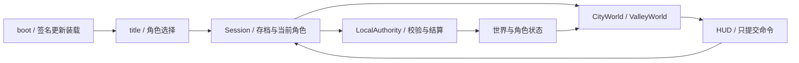

# 兔兔的世界 · 开发接手指南

更新：2026-11-02（0.3.0）。本文以当前源代码和已验证行为为准，是项目的开发入口；旧阶段说明已合并，历史过程只保留在工作区的离线归档中。后续功能变更直接更新本文对应章节、测试分组和验证基线，不再追加逐轮过程长文。

## 1. 先运行，再修改

- 引擎：**Godot 4.6.3**，桌面 Forward+；macOS 使用 Metal，物理使用 Jolt，开启物理插值。
- 无需 Node、npm、建模插件或在线资源下载。开发脚本使用 **Python 3.9+ 标准库**。
- 用 Godot 打开本目录 `project.godot`，F5；正式启动链是 `boot.tscn → title.tscn → city.tscn / valley.tscn`。
- 当前同时支持单人及服务器权威多人公共世界，账号注册/登录后选择在线角色；在线进度独立保存，详见[多人公共世界](多人模式设计草案.md)。

在项目根目录运行：

```sh
# 自动寻找 PATH、桌面或 /Applications 中的 Godot
python3 tools/dev.py doctor
python3 tools/dev.py test --suite smoke

# 其他机器可指定引擎二进制；Windows 可指向 Godot .exe
GODOT_BIN=/path/to/Godot python3 tools/dev.py test --suite rules
python3 tools/dev.py --godot /path/to/Godot run
```

`run` 使用真实进度；测试入口始终追加 `--test`，不读取玩家主存档。测试证据写入忽略提交的 `.qa-artifacts/<时间>/<测试名>/`，不再依赖原开发者的用户目录。第一次导入项目时，让 Godot 完成字体、贴图和脚本索引导入。

### 操作与体验入口

WASD / 方向键移动；Shift **切换**走跑；空格跳跃；右键拖动视角、滚轮缩放；E 互动；F 快捷照料**同一浮空圆球选中的作物**；C 角色、I/B 背包、Tab 换装、M 地图、Esc 返回/取消/设置；R 发呆；F2 取景；F12 截图。E/F 的必要操作提示应保留。

标题可创建兔兔、猫咪、熊猫，名字 1～12 字，同档不重名。九件初始服饰中**合计只赠一件**，不是每个槽位各一件。各角色共用同一座岛；背包、钱、经验、技能、耐力、穿搭、地图与位置独立。

## 2. 当前可玩内容及规则

策划调整请从[策划数值与机制文档](策划数值与机制/README.md)开始。该目录初稿已按2026-11-01代码填入现有数据，后续手工修改表达目标设计，需要与当前代码核对后开发；不会自动生效。本文继续描述当前实现，已实现变更应同步更新对应说明。

### 两张地图

| 地图 | 内容与入口 |
| --- | --- |
| 海岛城 `city` | 中央公园、北部商业区、东部 48 格菜园、南岸沙滩、西部住宅。种子/工具/服装三店可直接步入，卖家在内部；厨房可烹饪，旁边餐桌可用餐。海风小屋有门、坐席和可睡床，进入不切地图。 |
| 眠风山谷 `valley` | 约 108×106 的通行范围；0/2/4 米平台、五座阶梯、小溪、拱桥和可步入的潘达小屋。南岸为敞向外海的小码头。 |

城镇码头互动点 `(13, 41.5)`，前往山谷 10 贝壳币；城镇返回落点 `(13, 0.2, 39.5)`。山谷返程点 `(-5.8, 47.2)`，返程免费；到达落点 `(-11, 0.2, 43)`。上述二维坐标为 X/Z，具体定义统一在 `scripts/valley/valley_layout.gd`，不要在 UI 和权威逻辑各维护一套。

城镇有三位商人、四位兔兔路人、猫咪老师和熊猫“又木”。商人不离店；漫步者在可达区域选择分散目的地，有撞墙/无进展后的退让与重规划。角色之间有实体碰撞。每位NPC有8句延续原版风格的随机对白，按世界时段筛选并避免紧邻重复；原有9位以最初5句为基础、各续写3句，三位商人另有各8句招呼，文字与时段按06号文档最新修订实现。对话使用场景气泡，交谈对象停下并朝向玩家。三位店主第一次E先说招呼，再按E打开购买窗口，Esc退出。

山谷有潘达与两位兔兔访客叶芽、溪豆。潘达 6:00～20:00 漫步，之后沿路线回床睡觉；熟睡时对话不会叫醒。访客 6:00～22:00 出现，约一秒渐隐/渐现，过渡中取消聊天、禁止互动，完全隐藏后停止动作和碰撞。夜间蝴蝶隐藏，萤火虫出现。

### 时间、动作与成长

**必须区分两套时间：**

- 操作等待、奔跑扣耐力、耐力恢复：现实秒。
- 昼夜、作物成长、刷新期限、食物效果：世界时钟。`LocalAuthority.DAY_SECONDS = 3600`，即现实一小时对应游戏一天；`state.time` 用该世界的累计秒数表示，UI 再换算 24 小时。
- 单人设置可调当天时分，保持剩余增益与刷新期限；不借此恢复耐力。联网模式不显示此入口且服务端拒绝调时。

| 系统 | 当前规则 |
| --- | --- |
| 种植 | 胡萝卜1天、生菜1.5天、番茄2天、南瓜/小麦3天。前3种要求种植Lv.1，南瓜Lv.3，小麦Lv.5；低于门槛不能进行任何种植照料或收获。每种作物可独立定义照料阶段，小麦为0/25/50/75%，其余为0/1/3/2/3；缺少照料暂停，大时间步不能跨过门槛。 |
| 基础工作 | 播种、浇水、除草、收获、一级采集和采橘子基础耗时 2 现实秒，有目标上方圆环。 |
| 工具和消耗 | 水壶、矿镐、采石锤、铜斧均永久保留；种子、除草剂、料理材料在成功结算时扣除，取消/失败不消耗。 |
| 耐力 | 初始 100；奔跑每累计 3 现实秒扣 1，不足周期跨停顿/保存保留。常规生产预留1，二级采集预留2；成功不重复扣，取消/失败按实际预留退回；自然每 30 秒恢复 1，睡眠每 15 秒恢复 1，支持离线恢复。 |
| 总经验 | 成功生产记录与技能经验同量的总经验：种植/一级采集+1，二级采集+2，料理按配方。交易、换装、吃饭不计经验。 |
| 技能 | 五项技能初始Lv.1、上限100；升级需求`(等级+1)×(等级+4)`，依次10/18/28/40/54。每级提供+1%对应速度，Lv.1即+1%。新规则通过角色字段`skill_rules_version=2`一次性将旧技能等级/经验重置为1/0，保留其他进度。 |
| 属性 | 0.15表示+15%；基础/装备/食物/技能加成相加。移动速度乘倍率，工作耗时除以倍率；奔跑再乘1.7和独立奔跑倍率。属性悬停列出来源，技能悬停显示用途。 |

正在进行的工作不跨重启恢复，也不凭存档发放奖励；保存快照会退回未完成工作预留的耐力。离线推进作物时仍会停在未满足的照料条件；单人世界离线补时最多七个现实天；公共世界按服务器起点持续推进，没有此截断。

### 采集与刷新

| 地图 | 节点数量 | 时间/工具 |
| --- | --- | --- |
| 城镇 | 树枝 5、铜矿 5、石灰石 5、橘子树 4 | 2 秒；树枝/橘子徒手，铜矿用矿镐，石灰石用采石锤 |
| 山谷 | 树枝 5、橘子树 5、铜矿 4、石灰石 4 | 同上 |
| 山谷 | 桦木倒木 5、铁矿 2、砂石 2 | 二级材料要求对应技能Lv.3，基础5秒、产量1份；分别用铜斧/矿镐/采石锤 |

橘子按刷新代次循环获得3/4/5个，吃收获速度（含种植等级）；采完果实消失。三物种摘果复用向外抬手轨迹，手臂与肩部过渡避开头部体积，结束恢复正常姿态。在背包吃一颗需3现实秒、恢复3点耐力，不加经验，不替换料理增益。各节点按稳定 ID 保存状态，成功后在 **1～2 游戏天**错开刷新；换角色、换地图不重置。铜斧目前在工具店售 160 贝壳币。资源定义入口为 `GameData.resources(map_id)`。

### 烹饪、吃饭、服装

配方原料与售价以`data/catalog.json`为准。7道料理：胡萝卜暖汤移动+15%、鲜蔬沙拉浇水+30%、番茄炖蔬菜采木+20%、南瓜浓汤耐力上限+20%、蜂蜜麦饼立即恢复30耐力、香烤麦面包奔跑+20%、田园蔬菜蛋饼采石+25%。南瓜汤要求烹饪Lv.3，后三道Lv.5，其余Lv.1；烹饪技能经验分别3/3/4/8/10/12/10。用餐6现实秒，持续加成维持1游戏天且替换上一餐；纯恢复料理保留已有增益。料理品质尚未实现。

作物播种/浇水/除草每次成功有机会品质+1；同要求等级10%，高10级达到50%，中间线性。品质上限由一次播种与实际所需照料次数推导，基础4作物6、小麦7；收获量`round(基础产量×(1+品质/上限/2))`。采矿/采石/采木（不含橘子）同门槛等级5%双倍产量，高10级25%，中间线性；一级门槛1，二级3。所有奖励只在成功结算时抽取，取消不消耗随机机会或材料。

服装现有27件，蝴蝶结含3种纯色和3种格纹；新造型按用户反馈缩小15%，贴合三物种头部/耳根，猫咪沿共用无缝头部表面数学适配，不重新生成成品模型。服装有头 `head`、身体 `body`、脖子 `neck` 三槽，同槽一件；重复点击“已穿戴”卸下。背包/商店/换装支持分类；交易原地更新数量、余额和按钮，保留滚动位置。服装店可免费组合试穿，购买独立确认，离店不保存试穿状态。属性、换装、服装店共用角色预览组件，隐藏时停止绘制。

## 3. 代码地图与职责



| 文件/目录 | 维护职责 |
| --- | --- |
| `scripts/services/session.gd` | 角色创建/选择、设置、存档迁移、离线补时、事件桥接、地图切换失败回滚 |
| `scripts/services/local_authority.gd` | 命令幂等、距离/地图/材料/耐力校验、单一计时任务、产出和技能结算 |
| `scripts/services/game_data.gd`、`character_stats.gd` | 目录/商店/资源定义，属性与技能曲线；服饰目录也在 GameData 组合，不只看静态 JSON |
| `scripts/city/city_world.gd` | 共用场景运行、目标选择、镜头、光照、交互、NPC；避免把经济结算写进这里 |
| `scripts/valley/valley_world.gd`、`valley_layout.gd` | 山谷地图差异、地形/河道/阶梯/码头坐标、玩家与 NPC 通行约束 |
| `scripts/valley/boat_travel.gd` | 遮罩内线程加载目标地图，再提交旅程命令、切场景；失败不扣船费 |
| `scripts/city/wander_navigation.gd`、`npc_driver.gd` | 一份分帧构建的障碍网格、连通分组、分区目的地池、真实高度路径与脱困 |
| `scripts/valley/panda_routine.gd`、`visitor_routine.gd` | 共用漫步基础上的睡眠/访客作息 |
| `scripts/characters/`、`config/animals/` | 共用控制、动作、睡姿与物种参数；模型在 `scenes/` |
| `scripts/city/outfit.gd`、`fabric_library.gd`、`work_props.gd` | 共用换装/布料缓存/工具持物与水流喷雾等工作表现 |
| `scripts/ui/` | 标题、角色创建、HUD、预览、头像、Buff、进度圈和 UI 样式 |
| `scripts/city/home_builder.gd`、`seabreeze_home.gd`、`shop_builder.gd` | 蓝图生成、室内剖切、门/床/灯具与交互挂点 |
| `scripts/city/scene_preparation.gd` | 加载遮罩下预热日夜、镜头、室内、衣服工具与人物预览，减少首次管线编译停顿 |
| `scripts/city/render_budget.gd`、`frame_pacer.gd` | 3D 像素预算、前后台帧率，独立于世界模拟时间 |
| `scripts/builders/scene_builder_base.gd` | 城市/猫咪生成器仍使用的公共辅助；没有自动建模入口，不会覆盖兔兔 |
| `tools/dev.py`、`tools/test_suites.json` | 可移植开发入口、测试分组、本地证据、超时与脚本错误保护 |

可复用的 `scripts/bunny.gd` 只有继承共用控制器的两行，仍被已确认的兔兔场景引用，**不是废代码**。`remote_transport.gd`是实际WebSocket传输；`session.gd`负责在线状态、令牌与重连，`online_world.gd`负责远端角色表现。`server/world_server.gd`复用Authority结算并运行真实地图物理，`server/auth_service.py`维护账号。

## 4. 存档、命令与联网

### 格式不要混淆

| 格式 | 当前版本/含义 |
| --- | --- |
| 磁盘存档外壳 | **schema 3**：`world`、`characters`、`active_character`、`settings`、`saved_at` |
| Authority 单角色运行快照 | `state.schema = 2`，组合当前角色与共享世界；不是磁盘外壳版本 |
| 命令协议 | 本地Authority内部协议1；联网握手协议2，绑定已登录角色，含唯一请求ID、verb与参数 |
| 更新签名清单 | `schema = 1`，与存档 schema 无关 |

保存位置仍叫 `user://island_city_v2.json`，文件名不代表 schema 版本。macOS 的 Godot 用户目录为 `~/Library/Application Support/TutuWorld/`。不要清理这个目录里的玩家存档、`.bak`、`.v2.bak`。

`Session.WORLD_KEYS` 目前是世界 ID、时间、菜地、全部地图资源；`CHARACTER_KEYS` 是名字、物种、地图、位置、钱、背包、穿搭、经验/技能、属性、耐力余秒、睡眠和食物效果等。通过 `Session.state()` 获取当前组合状态。持久化用 `.tmp` → 原子改名，并保留 `.bak`；旧 schema 2 迁移为一位已有角色，首次迁移保存永久 `.v2.bak`。

UI 调 `Session.dispatch(verb, args)`；Authority 校验并执行，同一角色一次一项工作。重复命令 ID 不重复扣费。`Session.create_character` / `select_character` 保存失败会回滚角色选择；旅程保存失败会回滚费用、地图和修订号。

离线耐力用 `Session.real_time_now()` 的时间戳；游戏显示时钟不是耐力时钟。在线模式由服务器接管可信时间、移动物理、权限、锁、命令幂等、存档与地图迁移；客户端只发送输入和操作请求。账号库与公共世界存于服务器，单人快照在进出线上模式时完整隔离。令牌保存在本机online_login.json，密码不落盘；通用设置另存preferences.json。

## 5. 角色、服装与动作的扩展约定

已确认的 `bunny.tscn`、`cat_teacher.tscn`、`panda.tscn` 是当前成品模型。不要为生成城市、调光或整理代码重新生成它们。兔兔眉眼基本固定，允许眨眼和进食嘴形；情绪靠肢体/附加物，四肢为极简柱状，不加入肘/膝关节。猫、熊猫也直立行走，动作不能复制三套。

新物种按以下顺序接入：

1. 维持 `Visual` 下 `Head/Eyes/Mouth`、`LeftArm/RightArm`、`LeftLeg/RightLeg`、`Tail` 和右臂 `Cup` 等语义挂点。
2. 添加 `config/animals/<id>.tres` 的 `RigProfile`，注册到 `animal_catalog.gd`；统一通过 `AnimalFactory.create(id)` 生成主角、NPC 和预览。
3. 尺寸、头部碰撞、步幅、手握点、颈部、耳边蝴蝶结、头像取景等通过 profile 适配。走跑/跳跃/睡觉/双手工具只修改 `animal_actor.gd` 等共用逻辑。
4. 模型本体不烘焙服装。验证三个槽、走跑跳坐睡、浇水喷雾、双手采石/矿/木、烹饪、进食、脚底接触与描边。

服装几何 `style`、纹样 `pattern`、主色 `color`、辅色 `accent`、尺度 `pattern_scale` 分离；格纹和花叶纹分别在 `assets/fabrics/`，由 `fabric_library.gd` 缓存材质。`Outfit.apply(actor, equipment, looks)` 已允许外观覆盖，但玩家自定义染色/纹样 UI 与持久化尚未做；正式加入时应一起扩展命令、存档和快照。

`SleepPose` 按颈部支点计算头身夹角、枕头支撑和被子位置；床、枕、被是独立部件，不用把角色头和身体分别硬移到不相连的位置。采矿/采石/伐木复用双手握点和命中轨迹，工具方向、目标点和视觉特效要一起验证。

## 6. 地形、碰撞、导航和镜头

| 位掩码 | 用途 |
| ---: | --- |
| 1 | 主要场景障碍、墙、外围山体，也被相机检测 |
| 2 | 玩家/NPC 角色，互相碰撞 |
| 4 | 灯柱、路牌等小摆件 |
| 8 | 真实步行表面、道路、桥、地形、隐形斜坡 |

角色查询 15；相机查询 **9（1+8）**；寻路障碍查询 **5（1+4）**、地面高度查询 8。**不要把坡道/地面改成 9 层**，否则寻路会把地面当障碍，导致上下平台断路。

- `can_walk` 是玩家大范围边界，依靠物理碰撞落地；`can_navigate` 额外限制 NPC 的陡坎。不能再把台地边缘整条封成玩家禁行带，否则从高处跳下可能各方向都被拦住。
- 五座石阶外观与行走碰撞分离：保留可见台阶，实际为连续隐形斜坡。共用控制器沿坡恒速，原小台阶辅助只作用于平面小坎，避免斜坡上逐帧抬升抖动。
- 镜头半径约 0.24 的小球先处理起点重叠，再扫掠到平滑插值后的候选坐标。只检查“目标相机坐标”而不检查插值结果，会在转角再次穿模。
- 山体轮廓形变烘焙进几何，碰撞跟随实际网格；只在 shader 推动表面会出现可见/可碰撞轮廓不一致。
- 导航网格共享、分帧构建，城镇 9765 格、山谷 11554 格；路径保留实际 Y，高度不写死 0。门/家具变更可用 `refresh_region(AABB)` 局部更新。
- 传送、换图和从床起身后同步清理速度并 `reset_physics_interpolation()`。

## 7. 美术、光影与性能预算

风格目标是鲜明柔和的生活模拟世界：避免泛白、全场统一过亮；白色角色仍应接收日夜和室内灯光。描边保持一致视觉厚度；不要为更清晰的黑白花纹把猫/熊猫改成不受光的自发光本体。

当前为实时方向光/阴影、小半径 SSAO、调色环境补光、少量局部阴影灯、灯晕与窗光材质，自定义天空/云/星星/海面；**没有全岛实时 GI、光线追踪或实时流体模拟**。路灯实际照明不应随玩家走近突然开关；用固定少数阴影灯控制成本。

均衡模式只把高分屏的 3D 像素预算控制在约 200 万，macOS 使用 MetalFX Spatial，其他 Forward+ 使用 FSR；UI 保持原生清晰，原生画质保留完整 3D 分辨率。帧率默认 60，可选 60/90/120/关闭，后台默认 20；后台继续推进世界，不使用修改 `Engine.time_scale` 来节能。

两地图共用 `spring_lawn_v1.png` 的细密草坪，已移除满地小草苗，用花丛/蕨叶/少量灌木做层次。城镇花卉按花冠半径避开街道、路缘、广场与资源点。草坪来源、提示词与使用方式见 [素材记录](../assets/terrain/ASSET_NOTES.md)。

山谷水面按高度分段，小瀑布使用弯曲面、纵向流线、泡沫和每处 32 颗 GPU 顶点动画水花；没有 CPU 每帧重建。溪口向外海渐变，色彩随昼夜更新。遮挡树木平滑淡出至完全隐藏，避免稳定状态的点阵残影。静态景物分区合批，家具模块不跨模块合并。

修改渲染后用真实窗口帧时间判断，不把某个 GPU 计时接口返回 0 当成“GPU 没在工作”。性能测试顺序运行，先加载预热再转镜头；不要为消除首次编译停顿永久降低材质、阴影或灯距。最近已知基线见 [验证基线](验证基线.md)。

## 8. 生成地图与房屋

正常开发不需要重新生成地图。修改生成器/蓝图后，备份对应地图及模块，再运行：

```sh
python3 tools/dev.py build city
python3 tools/dev.py build valley
```

开发入口强制使用**有图形窗口的 GL Compatibility**。不要用 `--headless` 生成/保存包含 MultiMesh 的地图；dummy 渲染器可能丢失实例缓冲。生成器自己也会拦截这种用法。两个命令应顺序运行，生成城市后再生成山谷，因为山谷复制城市环境基底。

| 生成来源 | 输出 |
| --- | --- |
| `scripts/city/build_city.gd` | `city_map.tscn`、海风小屋及三家店铺模块 |
| `scripts/valley/build_valley.gd` | `valley_map.scn`、`valley_home.scn` |
| `data/houses/seabreeze_cottage.json` | 海风小屋蓝图 |
| `data/houses/mianfeng_cottage.json` | 潘达独立森林主题蓝图，同为 12×10、不同内部布局 |

原 `scripts/build_scene.gd` 已移除。仍在使用的 `group/save_scene/build_environment/flower` 辅助已抽到无自动入口的 `scene_builder_base.gd`。猫/熊猫生成器是**明确修改物种时**的工具，不是地图构建步骤。

房屋保存结构化 `building_definition`，墙段/洞口/地板/屋顶/家具/交互挂点独立，家具保留模块 ID、类型、变换与子碰撞。门窗应有真实洞口；移动家具时碰撞和交互点须一起移动。潘达床边出口目前在床的本地 X=-2.6 一侧，不能挪回被室内家具挡住的位置。

后续建造建议沿用“地块/楼层/墙边/洞口/家具变换”的数据层，预览与提交分离，经 Authority 校验后局部重建几何/碰撞/导航；再增加撤销、费用、保存和共享权限。当前只有结构参考，**尚未实现玩家建造编辑器、扩建、多层房屋或建造事务**。GI 也未为可改建筑接入，不能假定现有固定场景光照可自动支持任意改建。

## 9. 怎么验证自己的修改

```sh
python3 tools/dev.py test --suite smoke       # 初次接手/路径、规则与实际双图入口
python3 tools/dev.py test --suite rules       # 无窗口规则/存档，较快
python3 tools/dev.py test --suite graphics    # 场景/物理/交互，耗时更长，顺序运行
python3 tools/dev.py test --suite performance # 城镇+山谷，60 FPS、预热后采样
python3 tools/dev.py test valley_camera_regression
```

分组定义在 `tools/test_suites.json`；还可以直接指定 `tests/` 下的测试名。**不要通配执行所有 `.gd`**：其中含辅助类、截图工具、不同渲染器诊断和需要额外前置条件的发布测试。`--suite visual` 是本地画面采集，不是自动判断美术质量的测试。

| 修改范围 | 优先测试 |
| --- | --- |
| 交易/种植/耐力/技能/持久化 | `skills_quality_rules`、`npc_dialogue_rules`、`fruit_reach_rules`、`city_rules`、`stamina_revision_rules`、`skill_experience_rules`、`character_roster_rules`、`valley_rules` |
| 目标提示、商店/试穿/列表滚动 | `town_polish_flow`、`shop_transaction_scroll`、`clothing_shop_preview` |
| 碰撞/坡道/相机/角色移动 | `valley_traversal_regression`、`valley_camera_regression`、`valley_movement` |
| 换图/作息/小屋 | `valley_journey`、`panda_valley_routine`、`valley_visitors_night`、`home_lighting_stability`、`forest_art_structure` |
| 模型/服装/工具 | `model_surface`、`trouser_compatibility`、`work_effects_revision`、`valley_shared_work`；三种物种都检查 |

每项默认最多 180 秒，脚本/着色器错误会停止，避免失败窗口空转；普通测试限 45 FPS，画面预览可更低。性能分组才加 `--benchmark --warmup-test`。不能仅凭退出码 0 忽略日志中的 FAIL。

所有截图保持本地。需要 AI 视觉检查时先采小尺寸 JPEG/局部图，只传必要变化，避免反复查看同一全尺寸 PNG；高清成果留在本地。不要为了交接重新上传整批旧截图/视频。

`update_download` 会连接真实更新服务器，默认拒绝运行，需显式 `--allow-network`。`update_integrity` 需要已有签名清单：

```sh
python3 tools/dev.py test update_integrity \
  --game-arg=--fixture --game-arg=/path/to/signed/manifest.json
```

不要为了本地测试下载完整发布包，也不要在未授权时运行发布脚本。

## 10. 更新、发布与尚未实现的部分

当前版本 **0.3.0 / build 3 / launcher 2 / 网络协议2**。新安装默认全屏、60 FPS上限、均衡画质；Windows模板导出NVIDIA/AMD高性能显卡请求，渲染器优先选择独立显卡。用户原有设置继续保留。

更新入口为 `https://47.119.37.251/tutuworld/manifest.json`。RSA-SHA256验签后下载PCK，校验大小与SHA256（上限256MiB），成功才写pending。支持自动下载重启，也可关闭自动更新后手动检查、下载、重启。下载停滞45秒时允许重试。更新服务不可用仍可玩单人；多人须与服务端最新build及协议完全一致。

**引导不得预加载Release、Session或UpdateClient。** `boot.gd`只预加载独立的`update_trust.gd`；挂载验签后的PCK，再动态加载游戏脚本，避免脚本缓存让新包仍执行旧版本。原生引导的build常量随原生包升级；以`TUTU_CLIENT_READY`核对实际挂载版本。launcher兼容性变更须重新下载原生安装包。

公钥可提交，私钥与SSH凭据不得进入源码、PCK、安装包或下载目录。`tools/build_release.py`生成Mac/Windows安装包、通用`city.pck`和专用`server.pck`；`tools/publish_release.py`签名、上传、核对远端哈希并原子切换清单，版本目录不可覆盖。`city.pck`包含完整双地图游戏。多人服务部署、备份和时钟操作见[服务器运维](服务器运维.md)。

尚未实现：料理品质及更多技能效果、制造系统、玩家染色/纹样UI、建造编辑器、跨服和共享仓库。首版仓库已按用户要求取消。

## 11. 已知限制与交接资料

- 仍是程序化风格化美术，模型/纹样可继续精修；不能把历史截图当成未来每台设备的效果保证。
- 山谷 GL 生成器退出时有原有两条约 21 KB 天空贴图释放诊断；现有图形运行验证未复现相同提示。
- 最近城镇海岸短测有单帧约 40 ms，原因未确认；“平均约 60 FPS”不等于永久无卡顿。没有测量应用独占功耗。
- 单人进度基于本机时间；多人位置、交互、资产与日历由服务器裁定。首版面向约5人公共世界，尚未做大规模容量测试。
- 技能经验上限为到达Lv.100的累计353,496，满级UI不显示下一等级需求；旧规则通过角色版本标记仅重置一次。作物品质归共享世界，不随角色切换重置。
- 正式源码仓库为 https://github.com/Tydge/tutuworld ，发布标签v0.3.0。玩家数据、密钥与构建产物不纳入Git。
- 独立工作区的本机流量监控不属于游戏运行依赖，不随游戏发布；代理流量可能归到代理进程，不能据此准确拆分原应用。

项目内保留：本文、README、[验证基线](验证基线.md)、[整理清单](整理清单.md)及草坪素材来源。工作区保留精简现状记录、精选截图和有效测试日志；旧过程记录/早期截图/demo 已从活跃目录移出，只在离线压缩归档中保留，恢复方式见整理清单。
