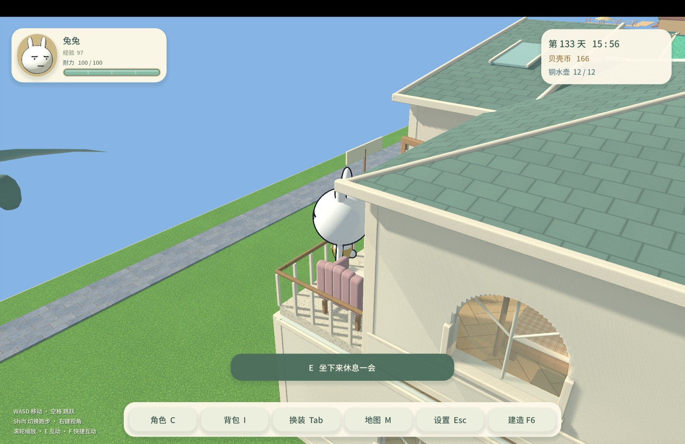
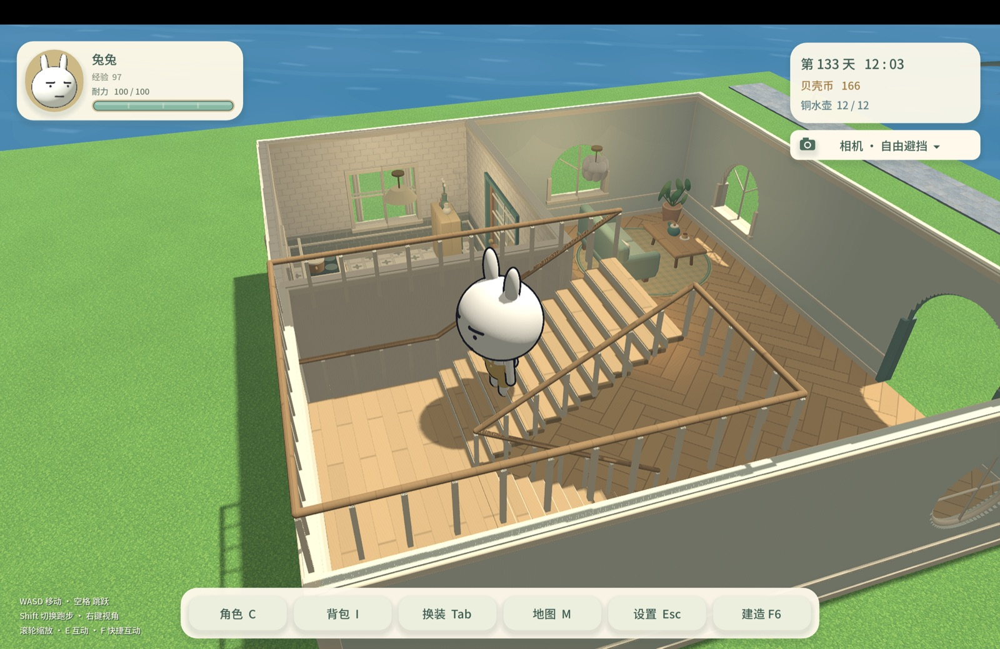
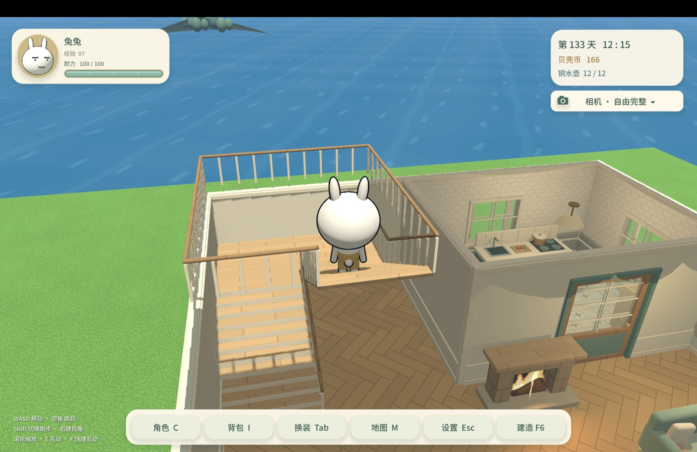
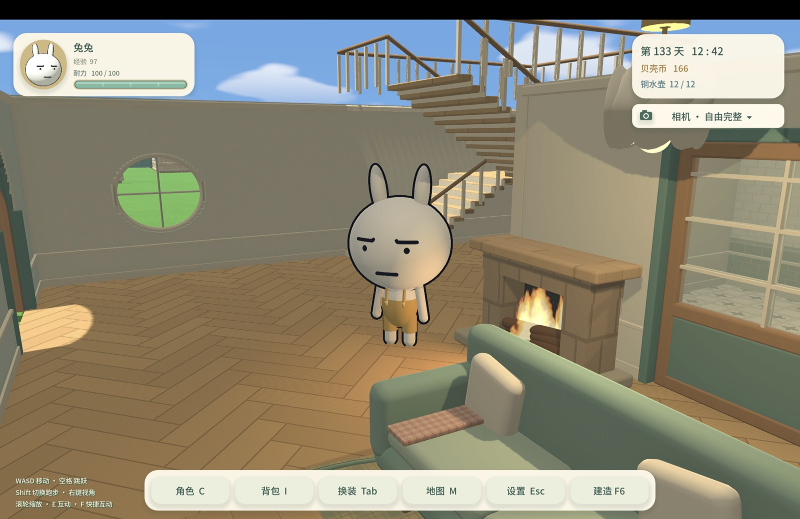
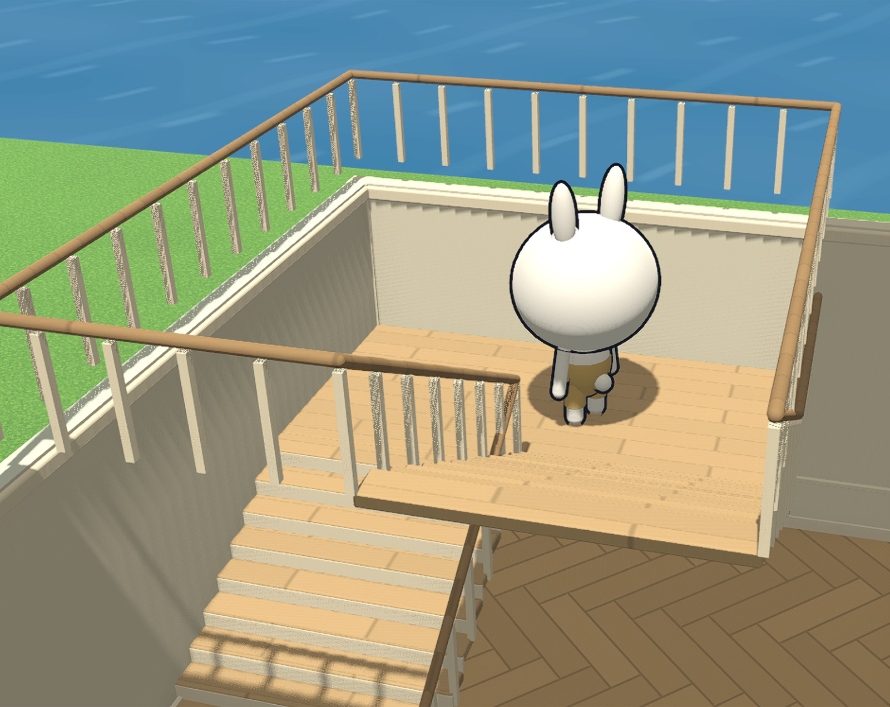
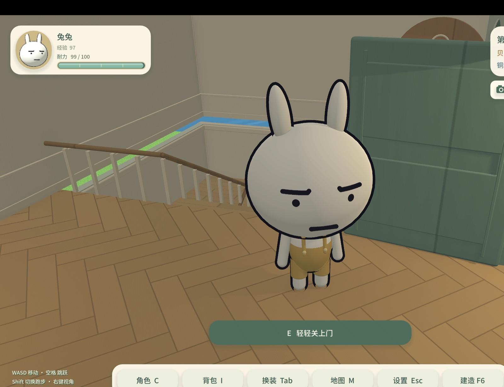
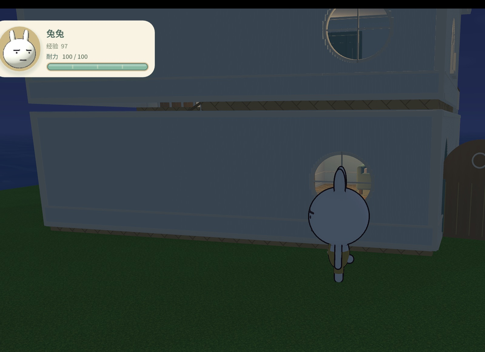

# 待修问题：多楼层显示与拼接

更新：2026-11-05。**以下问题均未修复，交给下一位开发处理。**用户要求本轮先更新接手资料、清理过时文件；本轮只读检查相关代码，未进行新的游戏内复现、修改游戏逻辑或重新验收这些缺陷。功能基线为源码提交`cb6723bb55433e76ffcff461f7c1f75e0b48d8e8`，正式安装包仍为0.3.3/build6。

用户在单人东岸两层样板房发现问题，已确认样板房实际出现在其本地进度中。不要把“下一次进入将添加样板房”继续写成对当前存档的确定描述；一次性增量添加机制仍适用于尚未添加的世界。下一步按下列现象复现，保留用户已有建筑、角色资产和进度，默认仅相关验证、源码提交推送，不部署发布。

## 问题清单

| ID | 玩家报告与复现位置 | 预期与验收重点 | 状态 |
| --- | --- | --- | --- |
| M01 | 阳台转到特定视角时整片海水消失，留下蓝色背景；回到屋里转视角后恢复（图1） | 从东岸阳台及房屋四周旋转、缩放、进出屋，海面始终存在；覆盖不同角色高度和远近视距 | 未修复；尚未代码复现 |
| M02 | 人在楼梯上，自由避挡和自由完整均看不见上方屋顶，室外日光直接照进楼梯间（图2、3） | 自由完整保留实际上方楼板/屋顶；自由避挡只移除真正挡住角色的视觉部分，持续保留遮光投影；上下楼过渡不忽隐忽现 | 未修复；尚未代码复现 |
| M03 | 一楼自由完整模式抬视角，楼上全部镂空能直接看到天空（图4） | 普通一楼天花应可见；楼梯洞处应看到楼上室内及真实屋顶，不能因隐藏上层而变成露天；相机不得穿过应保留的楼板/屋顶 | 未修复；尚未代码复现 |
| M04 | 楼梯平台及楼梯井周边栏杆竖杆悬空，没有落在平台或上层楼板边缘（图5、6） | 区分平台护栏、斜段扶手、楼梯井上沿护栏；所有支撑有正确落点，连接连续，三种楼梯及旋转朝向均需检查 | 未修复；尚未代码复现 |
| M05 | 二楼自由完整室内能从外墙下方长缝看到草地/海面（图6）；在屋外看一、二层之间也确有整条缝（补充图7） | 室内、室外及楼梯洞边缘均无贯通缝隙；楼板侧边/层间封边/上下墙正确衔接，同时保留真实楼梯洞和阳台开口 | 未修复；尚未代码复现 |

M02/M03可能共享上层显示策略，M04/M05也可能被隐藏楼板放大；不要在尚未验证时将它们合并为一个已定位原因，或只调整样板房坐标掩盖通用建造问题。

## 已读代码与排查线索

以下是静态代码事实及推测，**不是已验证根因，也没有应用修复**。

- **海面距离剔除**：`scripts/city/build_city.gd::build_city_island()`以原点附近半径4000的圆柱生成海面，之后静态合批代码会给批次设置`visibility_range_end=145`及12米边界；`scripts/city/static_batches.gd::bake()`同样使用这组值。样板房中心在X=139附近，阳台镜头可能跨过该阈值。优先检查实际加载的`city_map.tscn`内哪些GeometryInstance使用`Island.sea_material`、批次中心/AABB和可见距离；确认海面是否随镜头越界被整批剔除。此关联很强，但尚未读取运行实例做确认。不要为试修而直接重建成品地图。
- **上层几何与遮光**：`scripts/building/building_world.gd::apply_storey_visibility()`在普通游玩且位于房屋/楼梯内时，将高于`visible_storey`的模块隐藏；紧邻上层的`floor_chunk`只保留`SHADOWS_ONLY`，上层屋顶和墙并不因此自动保留投影。`refresh_view()`之后才按AUTO/FULL/OCCLUSION处理可见剖切段；因此“自由完整”也不能恢复已经被父节点隐藏的上层几何。需一起检查楼梯高度缓冲、楼梯洞视线和镜头排除列表。
- **楼层高度与封边**：`storeys.gd`层距4.7米、落脚高0.18米；墙净高4.4米。`module_factory.gd::build_floor_mesh()`及其碰撞都用中心Y=0.03、厚0.30的楼板，楼层平移另加4.7。正常楼板应填上下墙之间的层间带，但隐藏楼板或楼梯派生开洞处可能露出整条空带；尚未验证具体是可见性、楼梯洞紧贴外墙缺少封边，还是另有几何问题。修正视觉的同时检查碰撞、投影与材料，避免共面闪烁。
- **两套护栏**：`scripts/building/stairs.gd::build()`先生成斜段/中间平台护栏，再按洞口边界生成Y=`Storeys.HEIGHT`的上层楼梯井护栏。整个楼梯模块挂在下层，普通游玩可能留下上层护栏却隐藏其旁边的上层楼板。需逐条核对竖杆底端坐标、相邻支撑和显示所属楼层，不宜把所有竖杆统一下拉或删掉保护碰撞。
- **相机与投影**：`scripts/city/city_world.gd::camera_safe_position()`直接排除`room.hidden_camera_bodies`；`interior_view.gd::roof_limit()`按当前`visible_storey`及`has_roof_at()`限制高度。显示层、真实天花、跨层楼梯洞和相机碰撞需联合验证，避免显示修好后相机穿屋顶或被不可见层卡住。已有`seabreeze_home.gd::register_cutaway()`的持久投影机制可作为对照，但不能据此宣称当前多层已遮光正确。

## 下一位开发的验证范围

1. 使用隔离测试存档重建同一`templates.gd::two_storey()`；如必须核对当前真实布局，先只读备份并遵守[存档约定](开发接手指南.md#必须保持的约定)。不要重置用户世界或靠删房重建解决。
2. 先以截图角度复现M01～M05，新增能在修复前失败的场景检查；静态节点可见性断言不足以验证天空漏出、日光漏入、海面整批剔除或栏杆落点，应结合真实帧截图/像素及世界坐标。
3. 在一楼、楼梯下段/中间平台/上段、二楼、阳台和屋外连续旋转/缩放，覆盖三种室内模式及昼夜；自由完整应保留封闭建筑，自由避挡仍须看到角色且保留合理投影。检查进出屋和切模式后的可见性恢复。
4. 几何改动需覆盖直/L/U、四个朝向及相邻层；保护正常上下楼、平台转角、洞口护栏碰撞、逐层建造和整栋外观。按改动选用现有`multistorey_flow`、`multistorey_editor_flow`、`multistorey_showcase_walk`与新专项，不要求完整回归或发布。
5. 若涉及楼层剔除、阴影或相机循环，短测原样板布局帧耗时/绘制调用，避免每帧重建网格、扫描全布局或盲目永久显示全部楼层。保留新证据后再更新修复状态。

上轮[验证与性能](多楼层验证与性能_2026-11-05.md)的24组1,435项属于当时的固定记录，**没有覆盖或排除本次玩家报告**，不得当作这些问题已经通过验收。原检查、性能数据、素材与发布历史均保留。

## 玩家截图

项目内保留1600像素宽的JPEG副本用于交接，原始PNG及SHA256在本机私有恢复归档中；[索引](evidence/multistorey-open-issues-20261105/screenshots.json)记录对应关系。文件不是自动测试截图。

图1：阳台视角海水消失。

图2：楼梯中途，自由避挡，上层与屋顶消失、日光照入。

图3：楼梯中途，自由完整，同样露天。

图4：一楼自由完整直接看到天空。

图5：平台及楼梯井护栏悬空。

图6：二楼室内墙脚贯通缝隙，兼有护栏落点问题。

图7：补充屋外视角，一二层之间确有长缝。

