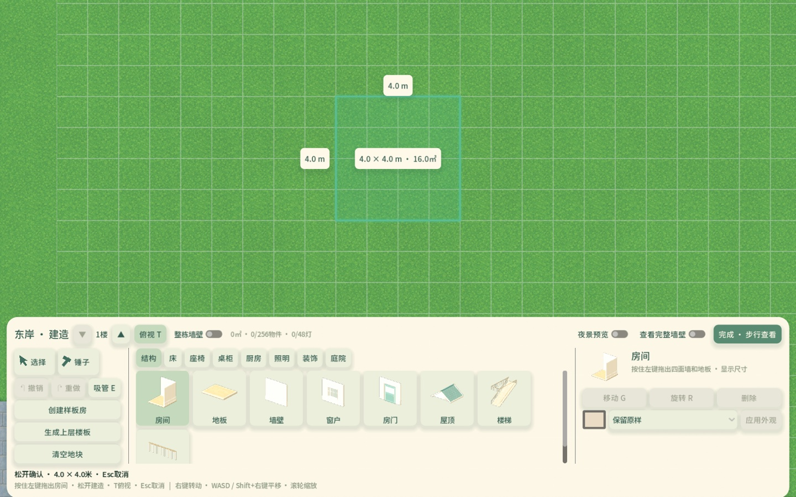
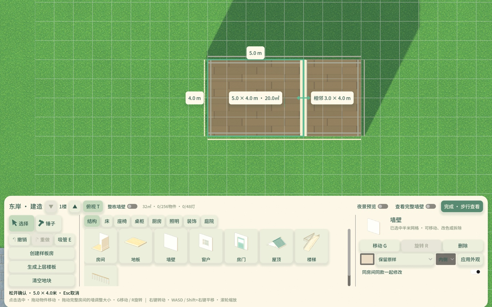
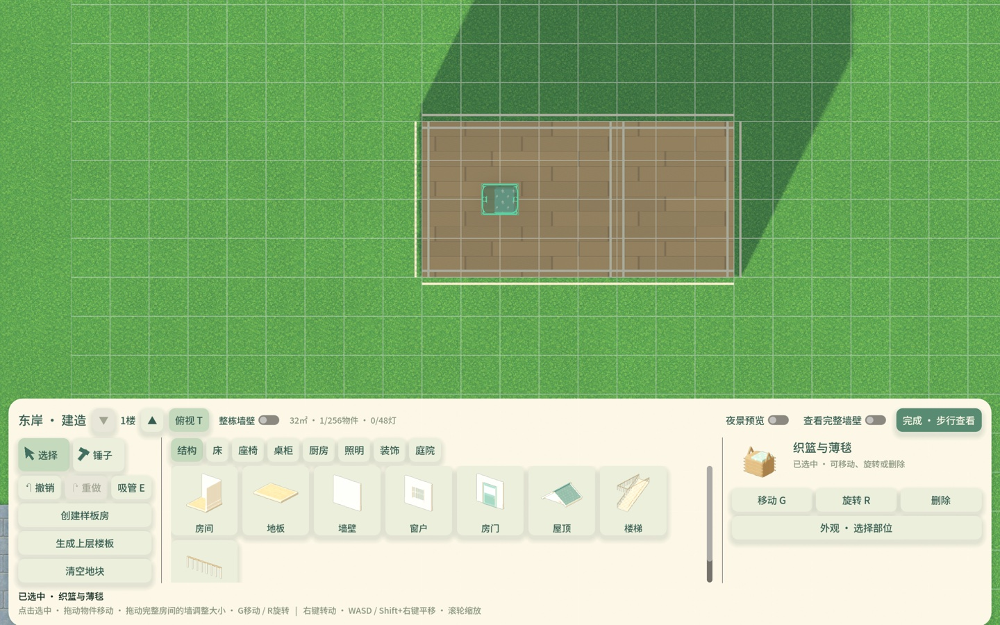
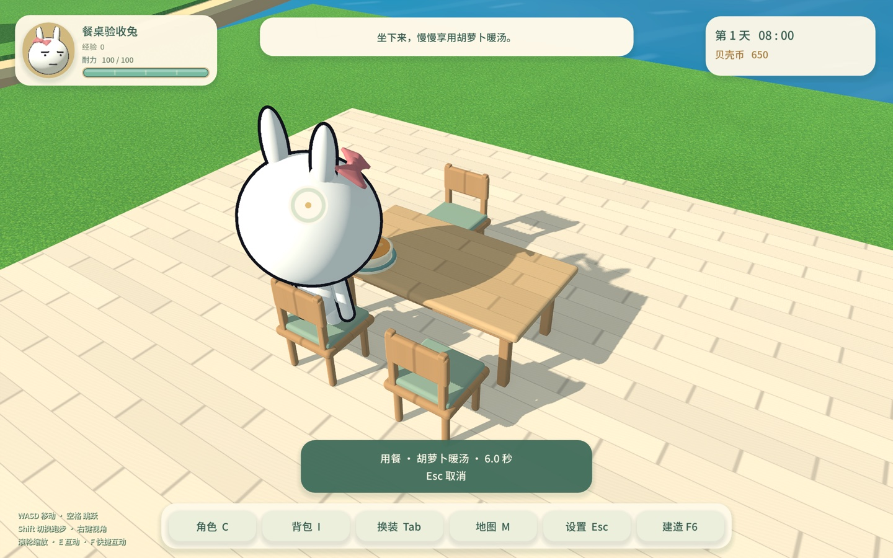

# 房间编辑、直接拖动与自建用餐验证

2026-11-06。修改在未发布源码，正式安装版仍为0.3.3/build6。本轮未部署、未生成地图、未改写真实进度及一次性迁移标记。

## 已实现的操作

- 结构→房间：拖出矩形，一次生成地板和四面墙；共用边合并。屋顶视图可在正确楼层拖建有支撑的上层房间。
- T：真正正交俯视，网格、边长和面积标注；再次切回原透视角。尺寸标签避免与相邻房间提示重叠。
- 选择模式：拖动闭合房间整面墙，调整房间；共用隔墙允许同时扩建/缩建。靠墙家具、台面摆件、门窗和匹配的屋顶边跟随。
- E：吸管复制家具同款、全部部位材质及布纹双色；墙地取样后沿用房间批量装修范围。
- 物件细轮廓显示选中状态，直接拖动物件移动，保留抓取偏移；G拿起、R旋转。点击仍只选中。
- 桌柜→橡木餐桌、座椅→软垫餐椅。分别放置，椅子靠近六个空位时吸附、朝向桌面；餐桌移动/旋转带配套餐椅与台面物件，单独动椅子不影响其他物件。删除餐桌保留餐椅。
- 靠近餐桌按E，使用原料理面板和原6秒吃食物流程。按距离自动找同层、未占用、能走到且能安全起身的餐椅；不弹选座。最近一把不合用时尝试下一把。取消不扣料理，完成扣一份，原食物效果和耐力恢复不变。

矩形房间最小1×1米、结构半米网格，仍为1～4层。非法拖动只显示红色预览与原因，松开不写入；包含家具/墙/护栏冲突、门窗净距、楼梯/平台、上下层楼板和吊灯支撑、旧屋顶局部相交、地块及房间闭合检查。提交继续经过全布局校验及原子建造检查点，整次一步撤销。Esc/右键取消拖动，失去窗口焦点也恢复原件。

本阶段尚无独立挂墙摆件；随后已加入挂画/壁镜/挂钟/壁灯并纳入跟墙与支撑校验，见[后续验证](墙面陈设与楼梯出口验证_2026-11-06.md)。本页计数与截图保留本阶段结果。自由角墙、整房复制/蓝图、个人外观预设和精细旋转未在本轮加入。

## 验证与固定证据

16组相关测试通过，共3060个计数检查；规则与图形用例分别按配置执行，计数含既有回归，不能作为彼此独立的功能数量。固定日志及源文件哈希见[summary.json](evidence/drafting-dining-20261106/summary.json)。

| 测试 | 覆盖 |
| --- | --- |
| drafting_rules · 51 | 四方向扩缩、共用隔墙双向调整、家具/摆件/门窗跟随、外部物件冲突、屋顶、上下层支撑/吊灯/楼梯、桌椅整组跟墙、预览不改原数据 |
| drafting_flow · 22 | 真实鼠标拖建4×4、外墙变5×4、共用墙变5×4和3×4、撤销、真俯视、物件细轮廓、直接拖动/G/E、部位和双色复制、墙地材料路径、取消、屋顶视图拖建上层 |
| dining_rules · 50 | 六椅配对、移动旋转、单椅独立、隔墙/跨层/重复位、整组冲突、全部原7种料理的6秒/取消/扣除/效果、权威端绑定椅子及完成复查 |
| dining_flow · 26 | 真实模型部位、编辑器整组预览/移动/R/撤销、真实E料理面板、最近椅/被占用后选下一把/受阻后选下一把、食物模型、原结算、安全起身、隔离真保存读回 |
| 其余12组 | project_integrity、building_controls、building_mouse_flow、building_revision_flow、building_surface_flow、furniture_access_flow、appearance_rules、kitchen_rules、storey_extension_rules、storey_extension_flow、multistorey_editor_flow、save_transactions |

执行入口：

```sh
python3 tools/dev.py test --suite building_drafting --windowed --timeout 240
```

主回归产物`.qa-artifacts/20261106-005310-182325`；补充上层房间/表面吸管后，完整性与两项房间测试复跑于`20261106-005635-252883`；最后调整尺寸标签布局后，鼠标图形路径复跑于`20261106-005806-790909`。固定证据为各测试最新通过结果，没有把修复前失败日志计入通过。









## 性能与边界

房间拓扑/占地按布局修订缓存，只有拖动改变半米格时计算，热预览限20Hz；松开强制最后一次校验。预览复用单面墙及跟随物件的网格，不每帧重建整屋、碰撞或写盘。选中细轮廓只复制所选物件共享网格，不使用全屏后处理。桌椅配对使用有界缓存，仅在布局变化时重新推导；最近空椅的占用及起身物理查询在发起用餐时进行。

40×32米封闭房、5120地板格，12次墙体拖动的纯规则CPU计算中位数3.60ms、最大3.76ms。该数字不含首次拓扑准备、渲染、完整提交/磁盘保存，不代表帧率。原有极端碎片布局的全量校验与检查点仍可能短暂停顿，不能承诺所有容量组合无卡顿。

图形实测为Mac / Apple M1 Pro / Godot4.6.3 / Metal Forward+，截图已人工复核。未运行Windows实机、极限容量叠加或长期会话帧率验证；不更改已有多人固定餐桌协议，自建家具继续仅限单人建造。
