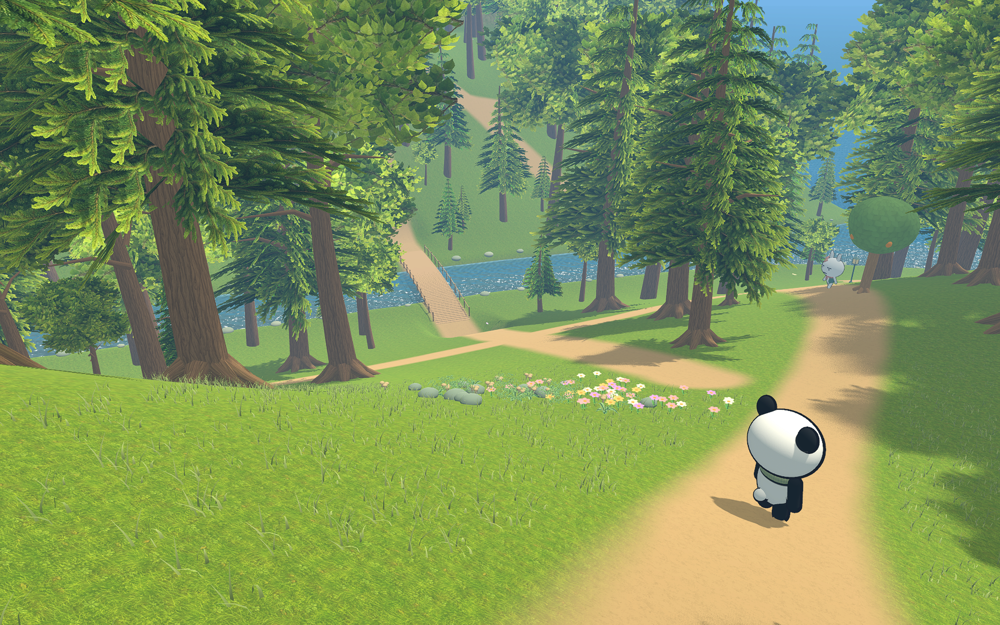
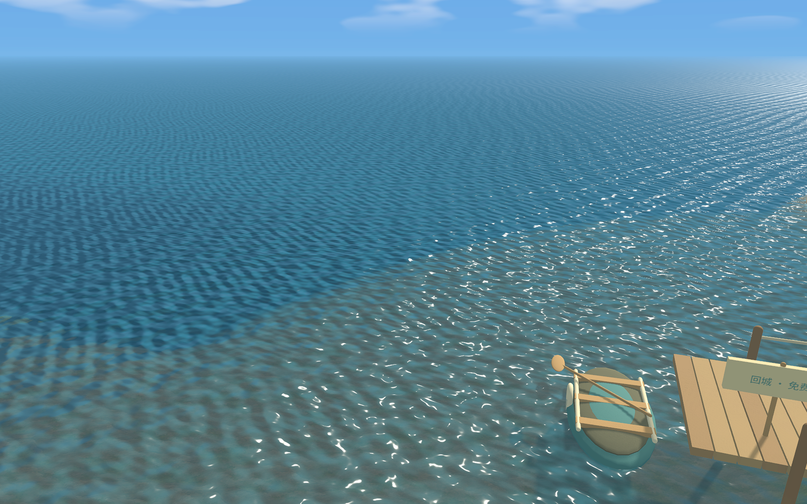

# 水体与连续山谷重做 · 2026-11-17

后续发布：下述山谷与水面已于同日随[0.4.1](0.4.1_发布记录_2026-11-17.md)正式上线，服务端迁移和远端联网验收已完成。以下保留最初本地开发阶段的范围和测量口径。

本轮仅本机开发与测试，**未导出、发布或部署**。正式服、下载包和在线更新仍为11-13发布的0.4.0/build7；不能把本页的本地新山谷写成已上线。开发工作树继续叠加原0.4改动，未回滚之前的多人建造、墙镜和角色修复。真实玩家存档未清空。

## 本地试玩

双击项目内 `tools/本地山谷预览.command`。它启动 `tools/local_valley_preview.gd`，强制要求 `--test`，创建独立熊猫测试角色，直接进入山腰。沿林间路继续上山，M打开包含等高线和观景点的新地图；南岸可以坐船回城。该入口不读取、写入或覆盖真实单人进度。普通F5仍读取真实进度，应与这个隔离预览区分。

## 地形和画面

尺寸参数从108×106变为216×212，水平范围各扩大两倍，面积为四倍。中央溪流保留，两岸改为连续高度场：地表、三角网格碰撞、资源落点、导航和植被共用 `valley_layout.gd` 的高度函数。旧的整块台地、五处阶梯和矩形围墙均退出当前地图。

两岸都有连续上山路线，可实际走到三十多米高的山腰；观景处比邻近河岸高二十多米。沿路线的最大坡度约0.605（高度/水平路程），地形连续性在整数网格、原台地分界及桥头以2毫米间隔检查，最大高度变化约0.00575米。小屋和码头的基础区通过平滑权重连接山坡，没有使用突然改变整块地面的方式。

最终地图包含271棵大树/幼树、220棵低成本远山树、36,728簇近景草、500朵成片野花、436处林下细节、107株河岸植物。杉/冷杉与阔叶树共用四套原型；近远模型、分区实例、无阴影的远树和草地距离控制限制开销。树根沿局部坡面贴地。观景方向留出林间空隙，近处枝叶只对主镜头的视线通道避挡，阴影与独立反射视图保留树木。维持明亮、温暖的游戏配色。

河流与山谷海面现在是同一张连续网格，河口海床平滑向深水延伸，避免双层透明水和海床截断产生接缝。共享水材质使用两层滚动法线、缓慢坐标扰动、深浅水颜色/透明度、掠射角变化、真实日光高光及轻微浅岸泡沫。城镇海面同步使用新材质；喷泉补充细波法线和真实高光。水体没有新增场景捕获相机、逐帧反射渲染或整图重新加载。

## 原有玩法与存档

27处资源的ID、种类、数量、工具/采集规则保持；陡坡上的旧落点调整到附近可站稳的坡面。三种角色都检查了采集、过桥、上坡、下坡和码头通路。猫/熊猫的方盒身体碰撞改为同高圆底胶囊，避免方盒上坡时由前角托起整个人物；模型、头部碰撞和角色身份记录保留。

本地角色新增 `valley_landscape_revision=2`：旧山谷坐标只转换一次，屋内和码头保留相对位置，其他旧落点映射到新地表。角色物种、背包、角色切换和资源耗尽状态保留。山腰恢复只在新景物实际与角色重叠时寻找替代位置，正常高处存档不会被送回码头。恢复与重叠树木的情况另有三物种回归检查。

未来发布必须成套更新客户端与服务器地图/坐标约定，并单独验收服务器持久角色的迁移；本轮没有连接或修改正式服，也没有验证“新客户端连接旧正式地图”的混用方式。

## 验证与性能

运行入口：

```sh
python3 tools/dev.py doctor
python3 tools/dev.py build valley --timeout 240
python3 tools/dev.py test --suite valley_landscape --windowed --timeout 240
```

当前截图入口为`valley_landscape_preview`。旧台地取景脚本已在同日清理中移除，可从功能快照`ae11b0b`恢复，不再作为当前验收入口。

地图必须用图形GL构建器生成压缩 `.scn`，不能用无头构建器重存含MultiMesh的地图。GL生成器退出时仍有两条各21,844字节的纹理清理提示；实际地图序列化、加载和运行检查通过。坐船测试补充正常释放场景后，已不再出现先前测试退出时的RID泄漏日志。

本机为Apple M1 Pro，Godot4.6.3/Metal/Forward+，输出3024×1890、原有“均衡”约200万3D像素预算、60FPS上限。没有降低既有预算来达标。旧山谷七处场景的p95为20.35～21.25ms；新山谷七处场景为18.31～19.98ms，采样均没有超过50ms的帧。两套地形/地标不同，这属于相同机器和设置下的场景对照，不能理解为严格同画面的算法加速率。

另用12秒快速穿行山路并转动镜头，触发实例分区、远近树和草地切换：平均约60.08FPS，p95为20.57ms，最长29.20ms，超过50ms为0帧；峰值1,135次绘制、约127万图元，报告总渲染显存约569.5MiB（含帧缓冲等，不能当作树木单独占用）。这些是本机均衡画质的短时实测，不代表原生满分辨率、其他硬件或任意长期负载保证。

最终日志、摘要和原图见 [固定证据](evidence/valley-landscape-20261117/summary.json)。其中包含地形规则、27资源和小屋连接、196项物理通行、33项实际输入通行、219项镜头/边界、15项高处恢复、往返航行、NPC作息、角色重启、素材结构、存档及原有楼梯回归。

## 素材来源与实机画面

树叶图集和森林草坪使用内置image_gen生成，原PNG复制不改像素；完整提示词、原输出路径和SHA256见 [素材记录](../assets/terrain/woodland/ASSET_NOTES.md)。512×512水波法线由确定性的波形生成工具制作，不依赖外部下载。树皮、泥路和苔岩沿用原有项目资产。

以下为Godot实机截图，不是概念图：






## 木栈道地面重叠修复（同日后续）

用户实测发现南岸木栈道有草地穿板和视角闪烁。复现时，420个码头木板采样点中，地面与板面最小间隔约0.00000066米；915个溪桥采样点还发现地面高出木板约0.00593米。

修复把木板覆盖区域的地面限制在板面下方，并按1米地形网格额外留出边缘余量，避免跨边界的三角面仍然穿板。外侧用平滑权重衔接原岸坡。码头板面高度与碰撞顶面由同一高度常量控制，维持原有通行高度，不改水面材质和渲染优先级。

重新生成地图后，完整28块码头板的最小间隔为0.120米；完整61块溪桥板为约0.1055米。实测昼夜、多角度画面，地形连续性检查以及兔、猫、熊猫的实际输入通行均通过。新增`valley_deck_clearance`从已保存地图的实例木板和实际地面碰撞取样，已加入`valley_landscape`套件；截图相机同时检查没有进入地形内部。

固定复现、修复后的日志与实机对照见[木栈道专项证据](evidence/valley-deck-clearance-20261117/summary.json)。本次仍仅修改本机源码和地图，没有发布或部署。隔离预览增加`--harbor`选项，可直接从码头岸边开始。
