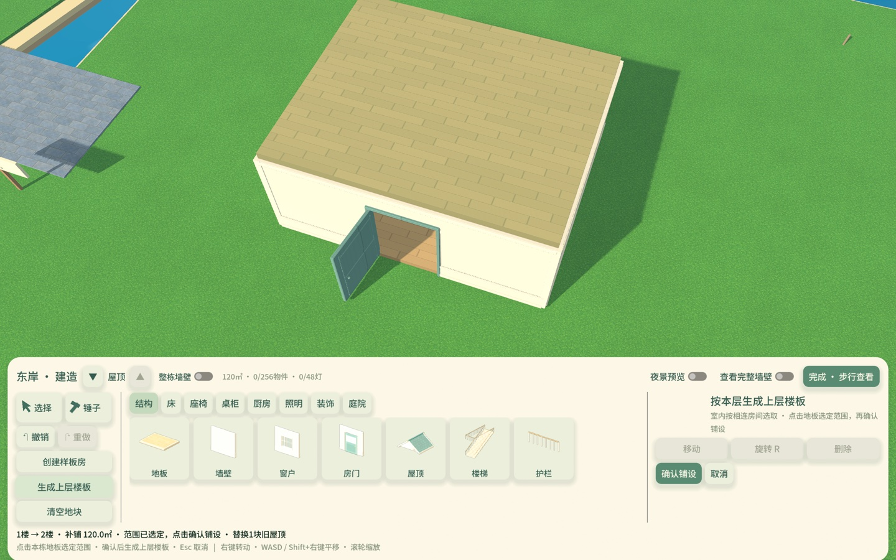
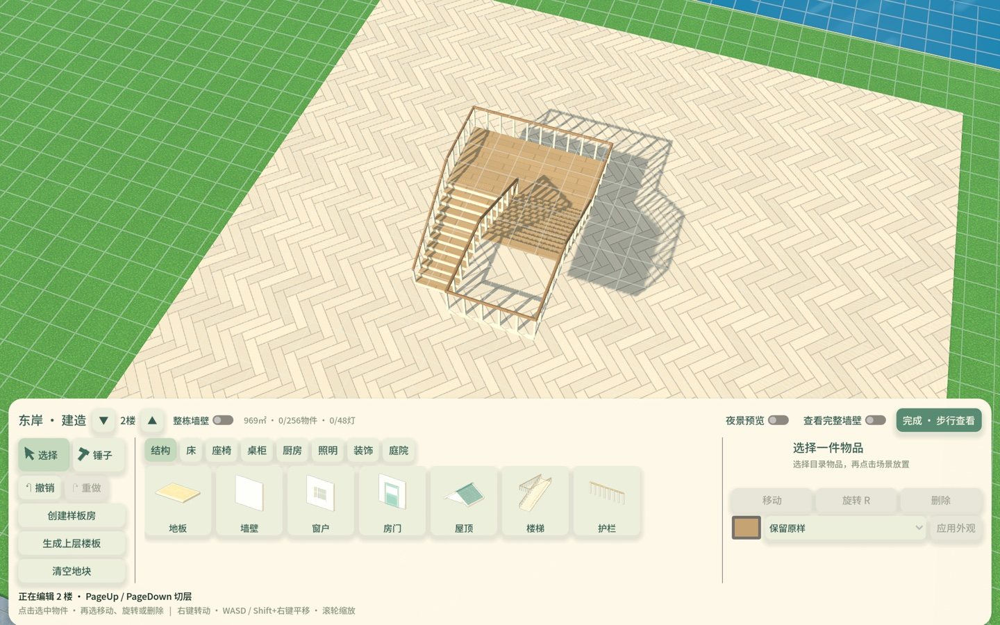
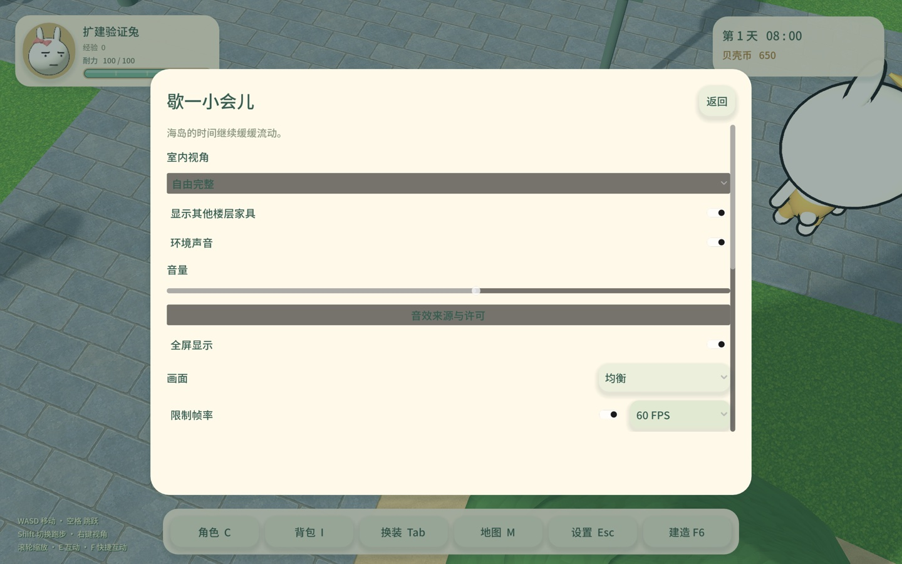

# 自动加层与跨层家具设置验证

2026-11-05～11-06，Godot 4.6.3 / Mac M1 Pro / Metal Forward+。源码已修改，正式安装版仍是0.3.3/build6，未部署发布。所有测试使用隔离角色与布局，不改真实玩家进度、备份或一次性样板迁移标记。

本页保存自动平台初版与跨层设置的固定证据。后续首座楼梯在本栋上层完全无板时已改为补齐本栋完整楼板，原3×3最小平台仅用于已有上层地板的补缺；见[最新验证](墙面陈设与楼梯出口验证_2026-11-06.md)。下方测试数字和截图仍对应初版，不是当前行为重测。

## 初版建造流程

- **先放楼梯**：下层已有入口地板即可选择楼梯。自动补齐上层缺少的3×3米落脚平台，沿用下层入口地板材质；已存在的上层地板和材质不覆盖。预览显示真实平台、入口/出口和护栏，无物理碰撞，也不写盘。确认通过原`Session.set_build_layout()`一次提交，放置一步撤销/重做。
- **平台与井沿护栏**：自动平台的外沿生成护栏，保留楼梯口与通往已有楼板的出口；没有上层楼板支撑的井沿不再生成悬空护栏。手工墙/护栏所在的边不重复生成自动护栏。楼板或手工护栏变化会通过缓存签名刷新受影响楼梯。
- **生成上层楼板**：底栏新按钮→指向本层房屋地板→点击选定范围→“确认铺设”。按实际网格单元复制轮廓，不使用包围矩形，因此保留凹角、手工空洞和楼梯洞；只补缺少的单元，已有上层装修不变。封闭房屋按相连室内房间选取，排除连接道路和独立房屋；未围墙时按相连地板选取，需检查预览范围。
- **屋顶与确认**：完整覆盖的旧屋顶随加层替换；预览提示数量，暂时隐藏将被替换的屋顶，以便看清新楼板，取消后恢复。支持保留下来的吊灯会保留，若失去支撑需移除，会在预览提示数量。局部扩建与旧屋顶相交仍拒绝，提示先调整屋顶。楼梯本身不会静默拆掉阻挡的旧屋顶，而是提示使用楼板生成入口或手工调整。
- **后续编辑**：完成后进入新楼层。自动补的平台为普通地板，可以独立改造；移动/删除楼梯不擅自拆掉已铺的平台，一次撤销原放置则同时恢复楼梯和平台。仍遵守四层上限和玩家脚下地板/下楼连接保护。

相关实现：`scripts/building/storey_extension.gd`负责纯布局计划；`editor.gd`与`editor_ui.gd`负责选范围、预览和确认；`stairs.gd`与`module_factory.gd`负责实际护栏及局部缓存更新。楼梯开洞仍由`walkable_grid()`派生，未增加存档schema或新存档格式。

## 跨层家具开关与另一栋房屋

设置增加“显示其他楼层家具”，默认开启，包括旧偏好文件没有此字段的情况。**自由完整/自由避挡**视角保留各层家具、摆件及灯具。自动俯视继续按当前层剖切，建造继续逐层编辑，避免上层悬空物件干扰当前层操作；开关说明中写明这个范围。

关闭后，只裁剪当前所在房屋的其他层家具，而不是同一个`PlayerBuiltHome`节点下的所有房子。当前层完整楼板覆盖的下层室内家具可隐藏，楼梯洞和露天区域按原规则保留。房屋划分使用相连室内房间；未围墙区域退化为相连地板。

屋外原本就会保留家具，能够透过门窗看见未进入房屋的家具；固定住宅、商店也没有“未访问就隐藏内部家具”的机制。正常墙体、屋顶和距离剔除仍会遮挡画面。这个开关不卸载模型、不改碰撞、不重建房屋；设置由Session存入本机偏好及完整存档。

## 本轮执行

| 测例 | 结果 | 覆盖 |
| --- | ---: | --- |
| `storey_extension_rules` | 1826项通过 | 三种楼梯×四个朝向×1～3楼，自动平台面积/材质，楼梯井、凹形轮廓、多房间/多房屋、连接道路、已有装修、旧屋顶及手工护栏避让 |
| `storey_extension_flow` | 132项通过 | 三种楼梯四向实际模型与物理支撑；兔子从U梯真实走到最小平台再下楼；按钮、预览/确认/取消、屋顶恢复、一步撤销/重做；跨层开关、另一栋房子和隔离真实磁盘重载 |
| `building_camera_template_flow` | 57项通过 | 上一轮触摸板、两套样板四向旋转，以及墙脚/书页材质交界移动镜头回归 |
| `multistorey_editor_flow` | 31项通过 | 逐层选择、三种楼梯预览、真实洞口与撤销 |
| `multistorey_repairs` | 651项通过 | 海面、结构遮光、相机限高、跨层封边与12组楼梯支撑 |
| `multistorey_persistence_rules` | 10项通过 | 四层原子检查点与磁盘重载 |
| `appearance_rules` | 168项通过 | 部位外观、视角遮挡和设置保存 |
| `building_feedback_flow` | 95项通过 | 楼层/屋顶导航、加层替换屋顶和窗预览复用 |
| `project_integrity` | 411项通过 | 资源及脚本完整性 |

固定日志摘要、哈希和截图见[证据索引](evidence/storey-extension-20261105/summary.json)。新增测例已注册到`building_feedback`和`building`套件。完整建造/联机回归、Windows、满容量性能以及所有物种在最小平台上的实走未在本轮执行；计数有重复组合，不能当作独立功能数量或帧率承诺。

后续尚未实现的建造体验建议见[对照《模拟人生3》的优先级](建造体验对照与优先级_2026-11-05.md)。
