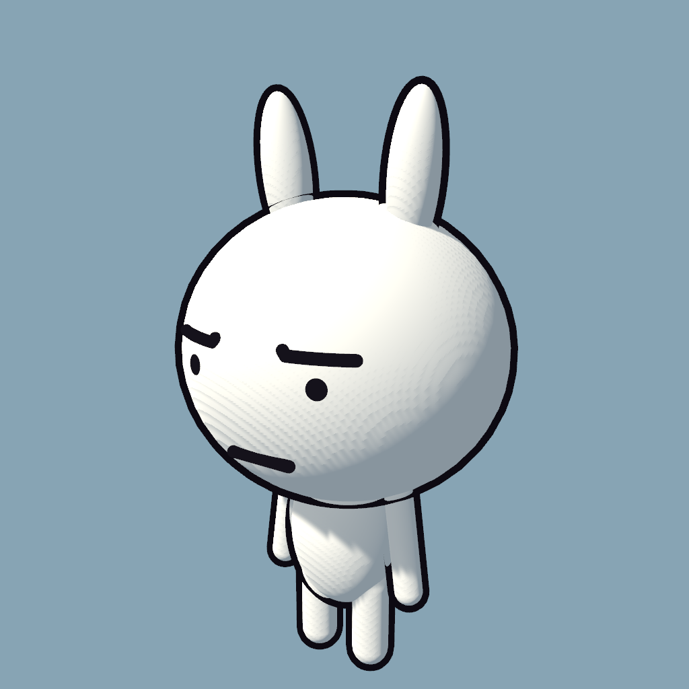
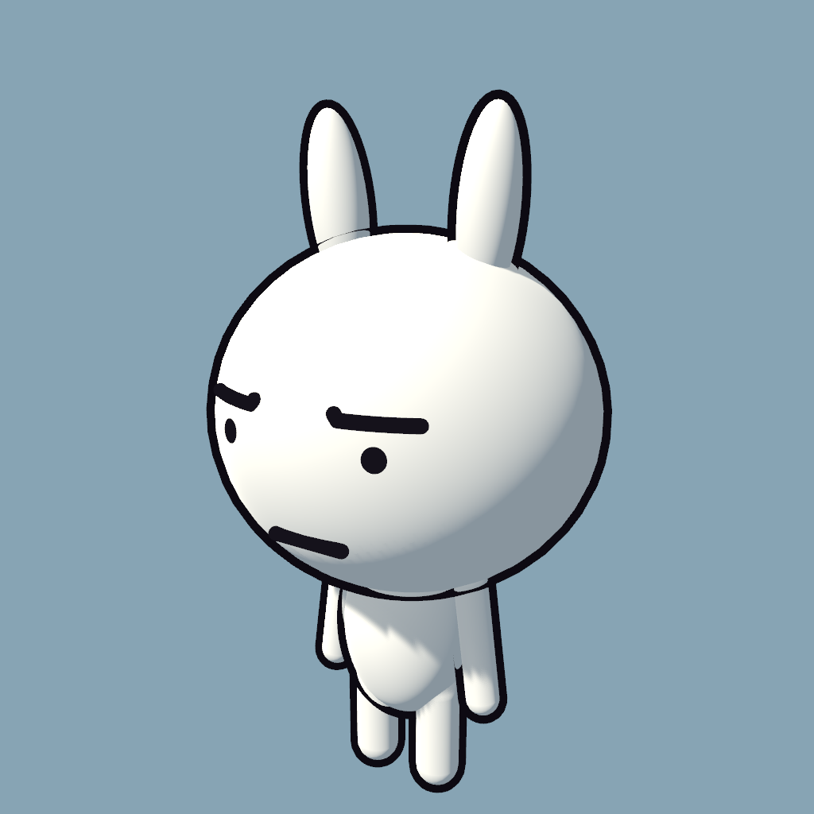

# 角色波纹阴影修复

后续状态（2026-11-18）：相关修复已随0.4.2正式发布部署，见[当前发布与清理记录](0.4.2_发布与清理记录_2026-11-18.md)。下文保留当时阶段记录。

2026-11-17，基于`efc8b92`追加，仅推送源码，未发布、未部署。Godot重新F5运行本地工程即可生效。

## 原因与修改

用户截图中的波纹是自阴影伪影。本轮在兔子头、身体和耳朵上复现；同样的设置也会影响猫、熊猫和普通球面的光照。上一轮把山谷太阳的法线偏移降到了0.35，同时阴影范围扩到160米、改用两个分区；深度偏移仍继承城镇的0.025，组合后不足以消除曲面上的阴影采样条纹。

`scripts/valley/valley_world.gd`将运行时太阳深度偏移调整为0.10、法线偏移恢复为0.65。保留160米阴影、两个分区、软阴影、树木独立投影、远近渐变和自然光照；没有新增绘制通道或提高阴影贴图尺寸。模型、材质贴图、碰撞和存档均未修改。[Godot对阴影偏移与自阴影的说明](https://docs.godotengine.org/en/4.6/tutorials/3d/lights_and_shadows.html#shadow-mapping)。

## 验证

新增`curved_shadow_surface`从真实山谷运行时代码取得太阳参数，使用三物种的实际头部网格和一个普通球体，覆盖三种太阳角度、两种镜头距离，共24组曲面。暂时隐藏其他部件以排除合法遮挡，比较“投射自身阴影”与“不投射自身阴影”时凸曲面的亮度；其余实景截图保留完整角色。

原代码24组曲面均失败，修复后50项检查全部通过。按亮度差大于0.015计，六种条件中的最坏异常像素占比：

| 曲面 | 原参数 | 修复后 |
| --- | ---: | ---: |
| 兔子头部 | 12.34% | 0.22% |
| 猫头部 | 10.02% | 0.48% |
| 熊猫头部 | 8.36% | 0.00% |
| 普通球体 | 12.29% | 0.07% |

测试同时验证接触地面的盒子在底部外4厘米和25厘米处仍有真实投影，防止靠关闭阴影或把影子推离物体掩盖波纹。山谷完整角色的实机画面另行复核。

共六组检查通过：曲面50、光照连续6、避挡投影稳定12、树木GPU渐变12、项目完整性476，合计556项计数检查，另有快速行走性能判定。本机M1 Pro/Metal/均衡约200万3D像素，12秒穿行平均60.08FPS、P95为19.92ms、最长23.89ms，超过50ms为0帧；这是短时本机测量，不代表其他硬件或原生满分辨率承诺。固定日志、数值、源码哈希与对照见[汇总](evidence/character-shadow-acne-20261117/summary.json)。

```sh
python3 tools/dev.py test curved_shadow_surface woodland_lighting_flow woodland_shadow_stability woodland_lod_flow woodland_sweep_performance project_integrity --windowed --timeout 240
```

全部使用隔离数据，测试窗口已退出；未访问正式服务器。上一轮性能与画面记录保留原时间点数据，本页为本次修复结果。

## 完整角色对照

同一套实际角色模型、固定灯光和镜头，仅改变两项偏移参数：




