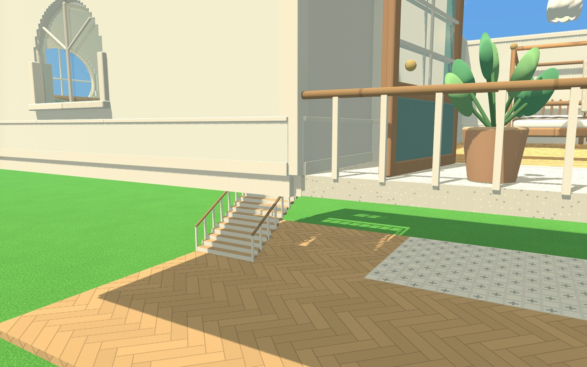
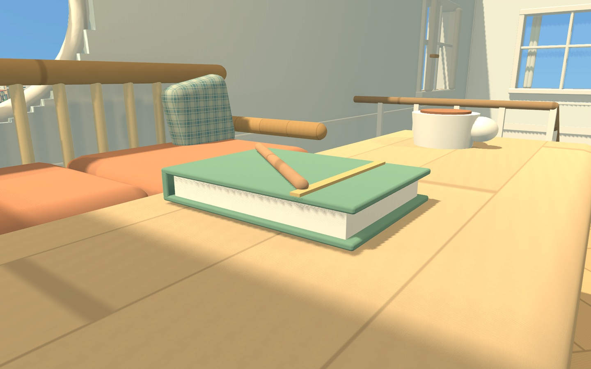

# 材质交界、触摸板镜头与样板房旋转

2026-11-05，Godot 4.6.3，Mac M1 Pro / Metal / Forward+。本轮修改源码并使用隔离测试进度验证，正式版仍为0.3.3/build6，未部署发布。

本页为11-05固定验证记录。随后已加入默认开启的跨层家具设置、首座楼梯整栋补板和建造UI滚动隔离；当前行为见[建造模式](建造模式.md)，最新证据见[验证基线](验证基线.md)。

## 已修复

1. **墙脚与楼板闪烁**：上一轮去掉了不同地板材质之间的内部侧面，但上层墙的`StoreyFascia`端面仍与楼板外沿共面。例如玩家两层楼阁的(140.5,4.75,17.5)附近，两种材质争抢同一深度，镜头移动时暴露问题。封边现在沿三个轴各多出1厘米，构成明确的收边厚度，端面不再与楼板外沿重合。保留实体碰撞和跨层遮光。
2. **田野手记书页**：原封面是一整块实心模型，书页嵌入其中，二者前面恰好都在局部Z=0.21。现拆成上下封面、书脊和独立书页。书封、书页、书签与笔仍保留原部位外观分组。
3. **Mac触摸板镜头**：游玩和建造相机共用`camera_zoom.gd`，支持`InputEventPanGesture`连续滚动、捏合及带精度系数的滚轮。原来只有离散滚轮分支。维持各自的距离上下限、暂停、文本输入及外观面板隔离。
4. **样板房旋转**：目录拿起样板房后，R或旋转按钮每次转90度；预览复用同一个模型。落地时围绕半米网格枢轴旋转各层结构、家具、楼梯、门窗挂点与朝向、墙面正负装修、台面摆件和依附ID。屋顶增加可选`yaw`，默认0；屋顶方向随保存、重载和单独移动预览保留。旋转后仍经原放置校验和原子检查点提交。

未关闭抗锯齿、SSAO或降低渲染档位。没有重建成品地图、覆盖既有房屋、改写真实进度或重置样板迁移标记。已放置样板仍由独立构件组成；本轮整屋旋转入口是**放置之前**，没有新增既有整栋房屋的组选取工具。

## 执行与证据

| 测例 | 结果 | 本轮关注点 |
| --- | ---: | --- |
| `building_camera_template_rules` | 1268项通过 | 两套模板0/90/180/270/360度、门窗朝向、实体墙面侧、摆件依附、奇数网格宽度、JSON重载及滚动精度/边界 |
| `building_camera_template_flow` | 57项通过 | 实际输入分发；两套样板四向预览与实际模型包围盒、撤销重做；楼板与封边、书封与书页的真实三角面相交检查；动态镜头截图 |
| `project_integrity` | 406项通过 | 源码与资源完整性 |
| `building_feedback_rules` | 146项通过 | 模板、门窗和灯具边界 |
| `building_feedback_flow` | 95项通过 | 楼层/屋顶、窗预览复用与新增楼板 |
| `building_feedback_visual` | 4项通过 | 内部地板侧面、目录与48盏灯实际渲染 |
| `multistorey_editor_flow` | 31项通过 | 逐层编辑、楼梯洞和撤销 |
| `multistorey_repairs` | 651项通过 | 跨层外壳、相机限高、海面、层间碰撞、12种楼梯支撑 |
| `building_controls` | 34项通过 | 实际视角转动、WASD平移、贴墙与保存 |
| `building_revision_rules` | 53项通过 | 旧模板调用兼容、冲突与依附重分配 |
| `multistorey_persistence_rules` | 10项通过 | 隔离存档、检查点、跨层重载 |
| `appearance_rules` | 168项通过 | 部位外观、遮挡与设置保存 |

固定摘要和精选画面见[证据](evidence/camera-template-joins-20261105/summary.json)。新增两项测例已加入`building_feedback`套件。全量建造/多人、Windows与真实手指触摸板操作未在本轮执行；输入验证通过Godot实际事件分发，非原生手势录制。

移动镜头检查：对墙脚和书页各8个连续镜头位置，比较到达位置后首帧与随后5次绘制稳定帧的中心区域（260×180像素，步长3）。两处平均颜色差、超过0.08的像素比例均为0。另检查实际生成三角面，确认楼板侧面与墙封边之间、书封与书页之间没有同朝向共面重叠。这个范围不等于全场景所有模型、距离和驱动的无闪烁证明；也不是帧率测试。

## 当时其他楼层家具消失的原因

`building_world.gd::apply_storey_visibility()`调整节点可见性。`Factory.sync()`已经构建全部楼层，其他层的节点、存档数据、碰撞及交互挂点都仍存在；这不是按需加载或卸载，不直接节省这些节点占用的内存。

- 逐层建造只显示当前层家具及相关楼板/楼梯；整栋墙壁或屋顶视图可用于跨层参照。
- 室内游玩隐藏上层家具；当前层完整楼板覆盖住的下层室内家具也隐藏，减少家具绘制、阴影和灯光成本。楼梯洞及室外家具按现有规则保留；在房屋外部则可显示各层家具。
- 外壳及遮光仍保留，避免看见天空或阳光穿透。显示状态按楼层/视角变化缓存，不逐帧重建模型。

代价是以楼层和楼板足迹判断可见性，并非对每件家具做真实遮挡判断；自由剖面可能看起来另一层空置。随后已实现默认开启的“显示其他楼层家具”，自由完整/自由避挡可保留跨层家具；关闭时只裁剪当前房屋，建造仍逐层显示。详见[设置验证](自动加层与跨层家具验证_2026-11-05.md)。不能在未测量前宣称能稳定增加多少FPS。

## 二层铺板建议的历史依据（后续已实现）

以下只保留设计依据。后续已实现先放楼梯和按轮廓生成楼板；首座楼梯在本栋上层无板时进一步改为补完整楼板，当前行为见[最新验证](墙面陈设与楼梯出口验证_2026-11-06.md)。

11-05提出建议前的规则要求先有上下层楼板才能放楼梯。建筑按世界半米网格对齐，没有任意角度的楼板；透视镜头下在高层选两个角容易选偏，使矩形与首层边缘错位。

建议提供两个互补入口：

1. **先放楼梯**：上层没有楼板时，预览并补齐最小落脚平台；楼梯、平台、洞口和护栏一次确认、一步撤销。仍校验入口、净空、旧屋顶和角色安全。已有上层楼板时不重复铺设，也不改其他材质。
2. **按本层轮廓生成上层楼板**：在楼层向上/屋顶入口提供按钮，默认采用当前这栋房屋的实际楼板单元，包含凹角而非简单包围矩形；预览后确认，保留楼梯洞，可继续增删。避免误复制道路、独立房屋或整块地皮；有露台或挑空时提供范围调整。

这个组合先解除“必须先手工铺好二楼才能放楼梯”的限制，同时给想复制整层的玩家一键入口。楼梯落下就无提示地铺满整栋，会妨碍挑空、阁楼和露台，因此整层铺设应可预览和选择。

《模拟人生3》允许从已有楼面直接放一整跑向上的楼梯，即使上层尚无楼板；也允许先在上层铺楼板再装楼梯。它不要求玩家在这两种先后顺序之间只选一种，也不等同于放一把楼梯就自动铺满二层。[楼梯教程](https://www.carls-sims-3-guide.com/buildedit/houses/multilevel/stairs.php)、[多层房屋教程](https://www.carls-sims-3-guide.com/buildedit/houses/multilevel/)。上述自动最小平台和一键轮廓铺板是本项目的建议设计，不能当作《模拟人生3》已有行为。
